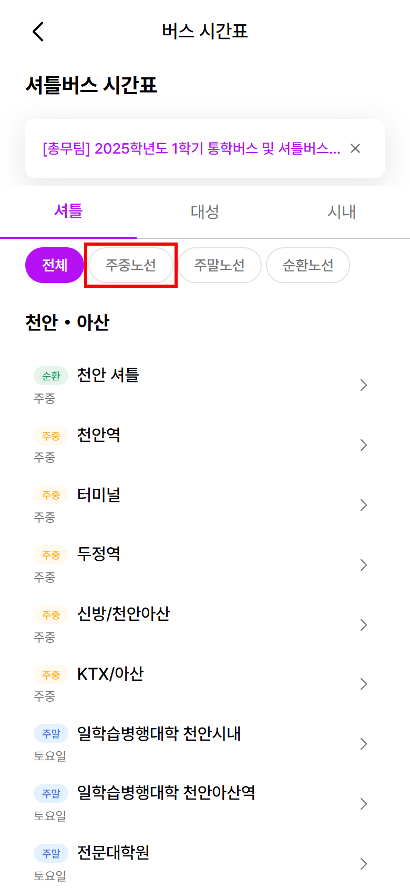

# 4-5. 셔틀버스 노선_클릭

원문 페이지 ID: 1ec0221954bc8204875481d904b5aaa0

> 원문 스냅샷. 명세 확정·앱 배포·수집 완료를 뜻하지 않습니다.

## 원문 속성

```json
{
  "platform": [
    "ANDROID",
    "IOS",
    "WEB"
  ],
  "url": "source-page-id:1ec0221954bc8204875481d904b5aaa0",
  "구분": "셔틀버스 시간표",
  "상태": "완료",
  "생성일": "2026-11-12T05:07:53.862Z",
  "이벤트 이름": "4-5. 셔틀버스 노선\\_클릭",
  "태그": [
    "4. 버스 시간표"
  ]
}
```

<details>
<summary>과거 로깅</summary>

- event\_label : “shuttle\_bus\_route”
- value : “전체<b>”, “주중노선”, “주말노선”, “순환노선”</b>
- event\_category : “click”
- 참고사진

<image source="assets/b794db5c-632b-459a-8183-c6d1b51cc501.png">
AND, IOS, WEB(Mobile view)
</image>

<image source="assets/ce3c0763-27ae-4139-8538-4fe40abb0b2e.png">
WEB
</image>
</details>

<details>
<summary>새 로깅</summary>

- 설명: 버스 시간표 화면 셔틀 탭에서 노선 필터(전체 / 주중노선 / 주말노선 / 순환노선)를 선택하는 경우
- screen\_view: <code>bus_timetable</code>
- event\_name: <code>DA1</code>
- event\_label: <code>bus__bus_timetable__filter__shuttle_route__select</code>
- value: 전체 / 주중노선 / 주말노선 / 순환노선 (예: 전체)
- event\_category: <code>select</code>

### 참고사진 (기능 표시)

<columns>
<column ratio="50">
<b>웹</b>

<b>참고사진 · 웹</b>

<image source="assets/f6d805a5-0a72-41ef-b66e-9829e659d206.png">
WEB · 빨간 네모: 셔틀 노선 필터 선택. stage 실제 화면 캡처에 위치 표시.
</image>
</column>
<column ratio="50">
<b>모바일</b>

<b>참고사진 · 모바일</b>

모바일 — 셔틀 노선 필터 선택 (출처: stage 실제 캡처, 빨간 네모 = 클릭 위치)


</column>
</columns>
</details>
