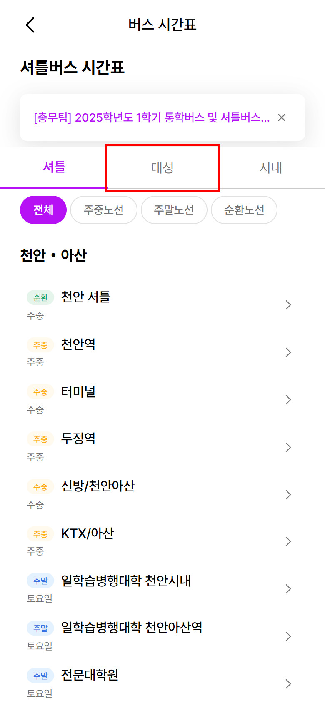

# 4-4. 버스 종류 탭_클릭

원문 페이지 ID: 23a0221954bc83859a5c81cb91f0e551

> 원문 스냅샷. 명세 확정·앱 배포·수집 완료를 뜻하지 않습니다.

## 원문 속성

```json
{
  "platform": [
    "ANDROID",
    "IOS",
    "WEB"
  ],
  "url": "source-page-id:23a0221954bc83859a5c81cb91f0e551",
  "상태": "로깅 필요",
  "생성일": "2026-11-12T05:07:53.754Z",
  "이벤트 이름": "4-4. 버스 종류 탭\\_클릭",
  "태그": [
    "4. 버스 시간표"
  ]
}
```

<details>
<summary>과거 로깅</summary>

- event\_label : “timetable\_bus\_type\_tab”
- value : “셔틀<b>”, “대성”, “시내”</b>
  - <span color="red">WEB</span>의 경우에도 로깅 시 “<span color="gray">학교</span>” 대신 “<b><span color="orange">셔틀</span></b>”로 부탁드립니다
- event\_category : “click”
- 참고사진

<image source="assets/9ad6b724-6857-438b-a480-22244f6e3f51.png">
AND, IOS, WEB(Mobile view)
</image>

<image source="assets/49a8a318-453f-4942-b88d-8e75f823acb5.png">
WEB
</image>
</details>

<details>
<summary>새 로깅</summary>

- 설명: 버스 시간표 화면에서 버스 종류 탭(셔틀 / 대성 / 시내)을 클릭하는 경우
- screen\_view: <code>bus_timetable</code>
- event\_name: <code>DA1</code>
- event\_label: <code>bus__bus_timetable__filter__bus_type__click</code>
- value: 셔틀 / 대성 / 시내 (WEB도 학교 대신 셔틀) (예: 셔틀)
- event\_category: <code>click</code>

### 참고사진 (기능 표시)

<columns>
<column ratio="50">
<b>웹</b>

<b>참고사진 · 웹</b>

<image source="assets/04b5702c-e18d-48ee-890b-638c416129c2.png">
WEB · 빨간 네모: 버스 종류 탭 클릭. stage 실제 화면 캡처에 위치 표시.
</image>
</column>
<column ratio="50">
<b>모바일</b>

<b>참고사진 · 모바일</b>

모바일 — 버스 종류 탭 (출처: stage 실제 캡처, 빨간 네모 = 클릭 위치)


</column>
</columns>
</details>
