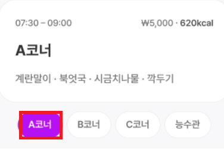
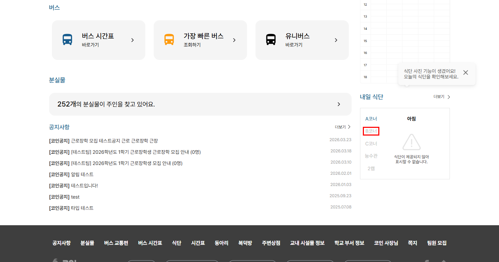
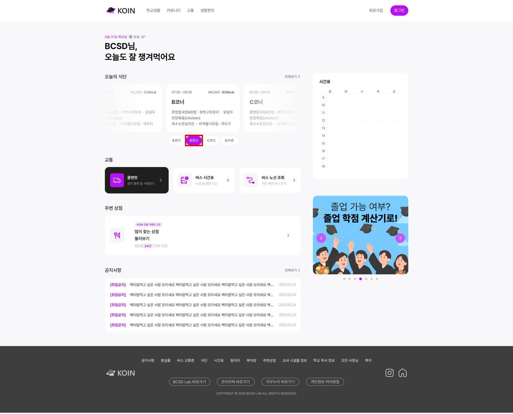
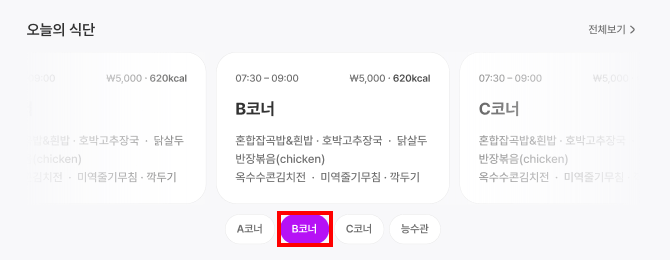

# 1-4 식단 코너 클릭

원문 페이지 ID: 3220221954bc83549c970136b8786c33

> 원문 스냅샷. 명세 확정·앱 배포·수집 완료를 뜻하지 않습니다.

## 원문 속성

```json
{
  "platform": [
    "ANDROID",
    "IOS",
    "WEB"
  ],
  "url": "source-page-id:3220221954bc83549c970136b8786c33",
  "구분": "홈화면",
  "상태": "완료",
  "생성일": "2026-11-08T10:52:04.099Z",
  "이벤트 이름": "1-4 식단 코너 클릭"
}
```

<callout icon="📌" color="blue_bg">
<b>현행 홈 로깅 기준 명세</b>

- 2026-11-04 사용자 결정으로 새 로깅을 이 페이지로 이관했다. 이전의 이 페이지 레거시 지정은 이 결정으로 대체한다.
- 이관 전 명세: 1-3.메인_식단_A코너_클릭 (레거시) (원문 ID: 1560221954bc83afacc8015e25700762) — 레거시 보존.
- 현행 event\_label: <code>main__main__corner__select</code>. 아래 ‘새 로깅’을 구현·전달 기준으로 사용한다.
</callout>

<details>
<summary>이전 로깅 · 참조 및 레거시 지정 이력 (현재 결정으로 대체됨)</summary>

<callout icon="📁" color="gray_bg">
<b>레거시 명세 · 이력 보존</b>

- 사용자 결정: 2026-11-04. 이 페이지는 레거시로 보존하며 별도 새 로깅 구현·추가 전송의 기준으로 사용하지 않는다.
- 관련 현행 기준 명세: 1-3.메인_식단_A코너_클릭 (레거시) (원문 ID: 1560221954bc83afacc8015e25700762).
- 기존 label·value·category·사진·플랫폼과 원문은 이력으로 유지한다. 기준 명세와의 value/category 차이가 모두 해소되었다는 뜻은 아니며, 이 문서 정리로 실제 SDK 수집 중단이나 중복 제거가 확인된 것은 아니다.
</callout>

- event\_label : menu\_corner
- value : A코너 / B코너 / C코너 / 능수관
- event\_category :  click





<details>
<summary>기준 명세 참조 (레거시 이력)</summary>

이력의 WEB 전체·확대 사진은 아래 현행 새 로깅과 동일 파일이므로 중복 첨부만 정리했다. 현재 클릭 위치 사진은 이 페이지의 ‘새 로깅 (26.11.04)’ 참고사진에 보존하며 이관 전 원본은 기존 레거시 페이지에 보존한다.

<details>
<summary>검토사항 · 중복·연관 명세 참조 (26.11.01)</summary>

- WEB 참고사진 반영 (2026-11-04 사용자 요청 정정): 아래 새 WEB 캡처와 빨간 네모·확대본을 기준으로 클릭 위치를 확인한다. 리디자인 전 WEB 사진은 이력으로 보존하며 모바일 사진·명세와 이전 로깅은 유지한다.
- WEB 리디자인 반영 (2026-11-04 사용자 승인): WEB: 식단 위젯의 코너 선택은 위젯 내용 전환이며 식단 페이지 진입과 구분한다. 기존 기준 명세의 corner/select를 참조하고 원문의 click과 value는 보존한다. Figma의 좌우 화살표가 코너 이동인지 별도 동작인지 미확인이므로 화살표에 새 라벨을 확정하지 않는다.
- WEB 설계 근거: [Figma 참고 / 실제 화면 미확인](https://www.figma.com/design/DPlcYuiFxhyT5ULbqec59i/KOIN-Web?node-id=11541-33352). 기존 사진은 교체하지 않았으며 리디자인 화면의 위치 근거로 사용하지 않는다. SDK 구현·배포 시점·실제 수집은 미확인이다. 이 WEB 규정은 해당 화면의 과거 WEB 설명보다 우선하며 모바일·이전 로깅·기존 필드 값·DB 플랫폼 속성은 보존한다.
- 메인 식단 코너 선택: 현행 관련 명세 1-3.메인_식단_A코너_클릭 (레거시) (원문 ID: 1560221954bc83afacc8015e25700762)를 참고한다.
- 홈 원문의 category click과 기준 select 및 값 범위가 다르다. 기준 명세를 참고하되 기존 category·value를 바꾸거나 두 번째 라벨을 추가하지 않는다.
- 사용자 요청에 따라 중복·연관 항목에는 별도 새 event\_label을 추가하지 않는다. 기존 원문·CAMPUS 지시·value·category·사진·DB 플랫폼과 상태를 보존한다. 레거시 보존 여부는 위 최신 사용자 결정에 따른다. SDK 중복 발화 여부와 실제 수집 중단 시점은 미확인이다.
- 같은 클릭에 문서 수만큼 이벤트를 추가하지 않는다. 실제 호출·플랫폼별 적용과 단일 전송은 개발 확인 필요다.
</details>

### 참고사진 (식단 코너 선택)

<b>웹</b>

<details>
<summary>참고사진 · 웹</summary>

WEB 리디자인 · [Figma 시안](https://www.figma.com/design/DPlcYuiFxhyT5ULbqec59i/KOIN-Web?node-id=11541-33352) · 2026-11-04. 빨간 네모는 이 명세의 클릭 위치다. 원본 캡처에 코드로 테두리만 표시했으며 실제 서비스 캡처·배포 완료를 의미하지 않는다. B코너 선택 예시이며 전체보기 버튼과 구분한다.

<b>전체 화면</b>

<b>클릭 위치 확대</b>
</details>

<b>모바일</b>

<details>
<summary>참고사진 · 모바일</summary>

이번 WEB 이미지 작업에서 별도 확인하지 않음. 기존 원문 사진과 모바일 명세는 그대로 보존한다.
</details>
</details>

<details>
<summary>구디자인 WEB 참고사진 이력 · 현행 WEB 기준 아님</summary>

새 로깅의 WEB 영역에서 분리한 기존 사진이다. 파일을 삭제하거나 변경하지 않았다.

<details>
<summary>이전 WEB 참고사진 (리디자인 전)</summary>

웹 — 메인 식단 코너 선택, 예: B코너 (출처: stage 실제 캡처, 빨간 네모 = 클릭 위치)


</details>
</details>
</details>

<details>
<summary>새 로깅 (26.11.04)</summary>

- 설명: 메인 화면 식단 위젯에서 코너 버튼(A코너 / B코너 / C코너 / 능수관 / 2캠퍼스)을 눌러 보이는 코너를 바꾸는 경우 (식단 화면으로 이동하지 않음). 1-3\~1-7 코너별 페이지를 이 라벨 하나로 합침
- screen\_view: <code>main</code>
- event\_name: <code>DA1</code>
- event\_label: <code>main__main__corner__select</code>
- value: \{코너\} → A코너 / B코너 / C코너 / 능수관 / 2캠퍼스 (예: B코너)
- event\_category: <code>select</code>

<details>
<summary>검토사항</summary>

- WEB 사진 기준 정리 (2026-11-04 사용자 지시): 새 로깅의 WEB 참고사진에는 리디자인 시안만 둔다. 구디자인 WEB 사진은 이전 로깅 이력으로 이동했다. 리디자인에서 버튼이 확인되지 않으면 사진 없이 미확인으로 표시한다. 라벨·value·category·event\_name·screen\_view·플랫폼과 모바일 사진은 유지한다.
- 현행 기준 이관 (2026-11-04 사용자 지시): 1-3.메인_식단_A코너_클릭 (레거시) (원문 ID: 1560221954bc83afacc8015e25700762)의 새 로깅 본문·사진을 이 페이지로 이관했다. 원본 페이지는 레거시로 보존하며 현행 기준은 이 홈 페이지다.
- 첫 구간 변경 (2026-11-04 사용자 지시): <code>cafeteria__main__corner__select</code> → <code>main__main__corner__select</code>. service\_name만 <code>main</code>으로 바꾸고 screen\_view·기능/detail·event\_name·value·category·발생 시점은 이관 원본대로 유지한다. 이전 홈 원문의 다른 value/category는 이전 로깅 이력이며 새 계약에 섞지 않는다.
- 적용 플랫폼은 이관 원본의 ANDROID / IOS / WEB 범위다. DB 플랫폼 속성은 변경하지 않았다. 실제 SDK 적용·배포·한 번 전송과 신규 라벨 수집은 미확인이다.
- 아래 과거 검토 메모의 변경 이력·동일 라벨 설명은 이관 전 계약에 대한 기록이다. 현재 적용 라벨과 기준 위치는 위 최신 결정이 우선한다. 문서 이관은 이벤트를 추가로 전송하라는 뜻이 아니다.
- WEB 참고사진 반영 (2026-11-04 사용자 요청 정정): 아래 새 WEB 캡처와 빨간 네모·확대본을 기준으로 클릭 위치를 확인한다. 리디자인 전 WEB 사진은 이력으로 보존하며 모바일 사진·명세와 이전 로깅은 유지한다.
- WEB 리디자인 반영 (2026-11-04 사용자 승인): WEB: 리디자인 홈의 A/B/C코너·능수관 등 코너 선택으로 표시 내용을 바꾸는 경우 기존 corner/select 명세를 적용한다. ‘전체보기’ 페이지 진입과 구분한다. 기존 value 범위는 보존하되 2캠퍼스 버튼은 지정 Figma에서 확인되지 않았으므로 존재를 가정해 새 버튼/전송을 만들지 않는다. 모바일 정의는 유지한다.
- WEB 설계 근거: [Figma 참고 / 실제 화면 미확인](https://www.figma.com/design/DPlcYuiFxhyT5ULbqec59i/KOIN-Web?node-id=11541-33352). 기존 사진은 교체하지 않았으며 리디자인 화면의 위치 근거로 사용하지 않는다. SDK 구현·배포 시점·실제 수집은 미확인이다. 이 WEB 규정은 해당 화면의 과거 WEB 설명보다 우선하며 모바일·이전 로깅·기존 필드 값·DB 플랫폼 속성은 보존한다.
- 통합 가이드·후속: [로깅 통합 가이드](3c30221954bc8214b1c481c5bbb6fba5.md)
- 2캠퍼스 버튼은 웹만 있음 (모바일은 A/B/C코너, 능수관)
- 참고사진은 B코너 예시 / web. 모바일 참고사진 추가 완료 (stage 캡처에 빨간 네모, 2026-10-28)
</details>

### 참고사진 (메인 식단 코너 선택)

<b>웹</b>

<details>
<summary>참고사진 · 웹</summary>

WEB 리디자인 · [Figma 시안](https://www.figma.com/design/DPlcYuiFxhyT5ULbqec59i/KOIN-Web?node-id=11541-33352) · 2026-11-04. 빨간 네모는 이 명세의 클릭 위치다. 원본 캡처에 코드로 테두리만 표시했으며 실제 서비스 캡처·배포 완료를 의미하지 않는다. B코너 선택 예시이며 전체보기 버튼과 구분한다.

<b>전체 화면</b>



<b>클릭 위치 확대</b>


</details>

<b>모바일</b>

<details>
<summary>참고사진 · 모바일</summary>

<image source="assets/34f5664d-324f-4e74-b02e-28c891470e3e.png">
WEB (모바일) · 빨간 네모: 코너 선택 버튼 클릭. stage 실제 화면 캡처에 위치 표시.
</image>
</details>
</details>
