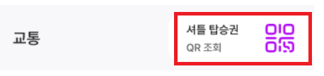
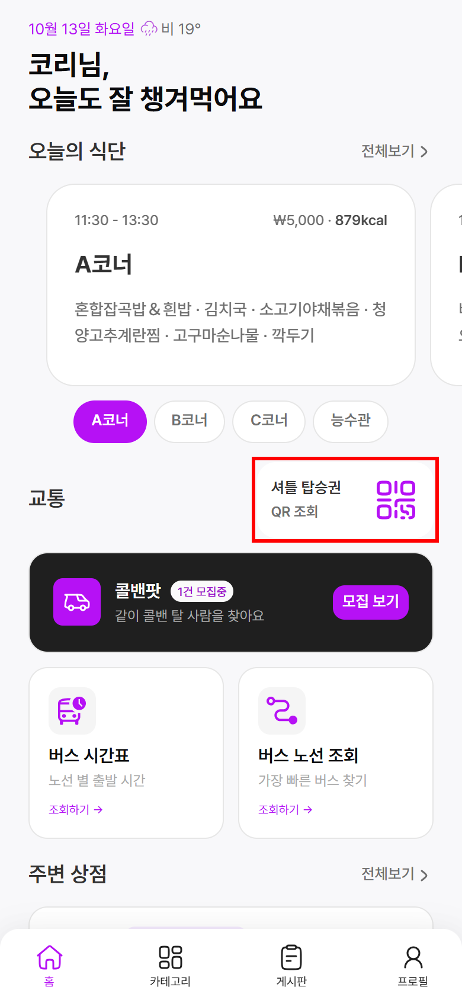

# 1-5 서틀 탑승권 클릭

원문 페이지 ID: 36c0221954bc836db2c2015d443eb2ea

> 원문 스냅샷. 명세 확정·앱 배포·수집 완료를 뜻하지 않습니다.

## 원문 속성

```json
{
  "platform": [
    "ANDROID",
    "IOS",
    "WEB"
  ],
  "url": "source-page-id:36c0221954bc836db2c2015d443eb2ea",
  "구분": "홈화면",
  "상태": "완료",
  "생성일": "2026-11-08T10:52:04.234Z",
  "이벤트 이름": "1-5 서틀 탑승권 클릭"
}
```

<callout icon="📌" color="blue_bg">
<b>현행 홈 로깅 기준 명세</b>

- 2026-11-04 사용자 결정으로 새 로깅을 이 페이지로 이관했다. 이전의 이 페이지 레거시 지정은 이 결정으로 대체한다.
- 이관 전 명세: [1-11. 셔틀 탑승권_클릭 (레거시)](1e10221954bc8268a989013ec93c6966.md) — 레거시 보존.
- 현행 event\_label: <code>main__main__bus_entry__ticket_entry__click</code>. 아래 ‘새 로깅’을 구현·전달 기준으로 사용한다.
</callout>

<details>
<summary>이전 로깅 · 참조 및 레거시 지정 이력 (현재 결정으로 대체됨)</summary>

<callout icon="📁" color="gray_bg">
<b>레거시 명세 · 이력 보존</b>

- 사용자 결정: 2026-11-04. 이 페이지는 레거시로 보존하며 별도 새 로깅 구현·추가 전송의 기준으로 사용하지 않는다.
- 관련 현행 기준 명세: [1-11. 셔틀 탑승권_클릭 (레거시)](1e10221954bc8268a989013ec93c6966.md).
- 기존 label·value·category·사진·플랫폼과 원문은 이력으로 유지한다. 기준 명세와의 value/category 차이가 모두 해소되었다는 뜻은 아니며, 이 문서 정리로 실제 SDK 수집 중단이나 중복 제거가 확인된 것은 아니다.
</callout>

- event\_label : shuttle\_ticket
- value : 셔틀 탑승권
- event\_category : click





<details>
<summary>검토사항 · 중복·연관 명세 참조 (26.11.01)</summary>

- WEB 리디자인 반영 (2026-11-04 사용자 승인): WEB 리디자인 홈의 교통 영역에서는 셔틀 탑승권 버튼이 확인되지 않는다. 해당 WEB 홈에는 이 이벤트를 연결하지 않는다. 모바일·다른 화면에서의 기존 기능 및 기준 명세는 유지하며 서비스 전체 종료를 뜻하지 않는다.
- WEB 설계 근거: [Figma 참고 / 실제 화면 미확인](https://www.figma.com/design/DPlcYuiFxhyT5ULbqec59i/KOIN-Web?node-id=11541-33352). 기존 사진은 교체하지 않았으며 리디자인 화면의 위치 근거로 사용하지 않는다. SDK 구현·배포 시점·실제 수집은 미확인이다. 이 WEB 규정은 해당 화면의 과거 WEB 설명보다 우선하며 모바일·이전 로깅·기존 필드 값·DB 플랫폼 속성은 보존한다.
- 메인 셔틀 탑승권 클릭: 현행 관련 명세 [1-11. 셔틀 탑승권_클릭 (레거시)](1e10221954bc8268a989013ec93c6966.md)를 참고한다.
- 동일한 셔틀 탑승권 목적의 명세를 참고한다. 플랫폼별 호출 지점·한 번 전송은 미확인이다.
- 사용자 요청에 따라 중복·연관 항목에는 별도 새 event\_label을 추가하지 않는다. 기존 원문·CAMPUS 지시·value·category·사진·DB 플랫폼과 상태를 보존한다. 레거시 보존 여부는 위 최신 사용자 결정에 따른다. SDK 중복 발화 여부와 실제 수집 중단 시점은 미확인이다.
- 같은 클릭에 문서 수만큼 이벤트를 추가하지 않는다. 실제 호출·플랫폼별 적용과 단일 전송은 개발 확인 필요다.
</details>

<details>
<summary>구디자인 WEB 참고사진 이력 · 현행 WEB 기준 아님</summary>

새 로깅의 WEB 영역에서 분리한 기존 사진이다. 파일을 삭제하거나 변경하지 않았다.

<details>
<summary>참고사진 · 웹</summary>

<image source="assets/1fe13da5-19cd-4d99-9119-b21823eb5a66.png">
WEB · 2026-10-30 운영 사이트 실제 캡처. 빨간 테두리=유니버스 진입 카드. PC 유니버스와 보라색 모바일 홈의 셔틀 탑승권 링크가 모두 [https://koreatech.unibus.kr/](https://koreatech.unibus.kr/) 인 것을 DOM href로 확인했다. 모달을 닫은 상태이며 실제 SDK 전송은 미확인이다.
</image>
</details>

<details>
<summary>교체 전 참고사진 · 웹 (이력)</summary>

<image source="assets/941d4927-0554-44fb-bdb8-50249b00ee5f.png">
WEB · 보유 stage 원본 캡처(2026-10-27)에 코드로 빨간 테두리만 표시. 메인 유니버스/셔틀 탑승권 카드의 보이는 진입 영역이며 팝업·문구·배치는 원본 그대로다. 2026-10-30 재편집; 실제 SDK 발화 검증과 별개.
</image>


</details>
</details>
</details>

<details>
<summary>새 로깅 (26.11.04)</summary>

- 설명: 메인 화면에서 셔틀 탑승권 버튼을 클릭하는 경우
- screen\_view: <code>main</code>
- event\_name: <code>DA1</code>
- event\_label: <code>main__main__bus_entry__ticket_entry__click</code>
- value: 셔틀 탑승권
- event\_category: <code>click</code>

<details>
<summary>검토사항</summary>

- WEB 사진 기준 정리 (2026-11-04 사용자 지시): 새 로깅의 WEB 참고사진에는 리디자인 시안만 둔다. 구디자인 WEB 사진은 이전 로깅 이력으로 이동했다. 리디자인에서 버튼이 확인되지 않으면 사진 없이 미확인으로 표시한다. 라벨·value·category·event\_name·screen\_view·플랫폼과 모바일 사진은 유지한다.
- 현행 기준 이관 (2026-11-04 사용자 지시): [1-11. 셔틀 탑승권_클릭 (레거시)](1e10221954bc8268a989013ec93c6966.md)의 새 로깅 본문·사진을 이 페이지로 이관했다. 원본 페이지는 레거시로 보존하며 현행 기준은 이 홈 페이지다.
- 첫 구간 변경 (2026-11-04 사용자 지시): <code>bus__main__bus_entry__ticket_entry__click</code> → <code>main__main__bus_entry__ticket_entry__click</code>. service\_name만 <code>main</code>으로 바꾸고 screen\_view·기능/detail·event\_name·value·category·발생 시점은 이관 원본대로 유지한다. 이전 홈 원문의 다른 value/category는 이전 로깅 이력이며 새 계약에 섞지 않는다.
- 적용 플랫폼은 이관 원본의 ANDROID / IOS / WEB 범위다. DB 플랫폼 속성은 변경하지 않았다. 실제 SDK 적용·배포·한 번 전송과 신규 라벨 수집은 미확인이다.
- 아래 과거 검토 메모의 변경 이력·동일 라벨 설명은 이관 전 계약에 대한 기록이다. 현재 적용 라벨과 기준 위치는 위 최신 결정이 우선한다. 문서 이관은 이벤트를 추가로 전송하라는 뜻이 아니다.
- 사진 링크 대응 확인 (2026-10-30): 운영 PC 유니버스 카드와 보라색 모바일 홈 셔틀 탑승권의 href가 모두 [https://koreatech.unibus.kr/](https://koreatech.unibus.kr/) 임을 실제 DOM에서 확인했다. 모달을 닫은 운영 WEB 사진으로 보완했다. 정적 링크 대응 확인이며 SDK 발화·네이티브 앱 동작은 미확인이다.
- 사진 재검수 (2026-10-30): 웹·보라색 모바일 웹을 실제 화면으로 교체하고 교체 전 사진을 이력으로 보존했다. UI 재생성 없이 검은색 개인정보 마스킹과 빨간 테두리만 적용했다. 기존 사진의 생성형 편집 여부는 이 작업에서 확정하지 않는다.
- 통합 가이드: [로깅 통합 가이드](3c30221954bc8214b1c481c5bbb6fba5.md)
- 웹/모바일 참고사진 추가 완료 (stage 캡처에 빨간 네모, 2026-10-28).
- label DA2 기준 정렬 (2026-10-27): <code>bus__main__shuttle_ticket__click</code> → <code>bus__main__bus_entry__ticket_entry__click</code>
- 사진 정정 (2026-10-30): 생성형 편집본과 동일했던 WEB 파일을 보유 stage 원본에 코드로 테두리만 그린 파일로 교체했다. 해상도·박스 밖 픽셀은 원본과 동일하며 이전 로깅·모바일 사진·라벨·필드는 유지한다.
</details>

### 참고사진 (기능 표시)

<b>웹</b>

<details>
<summary>참고사진 · 웹</summary>

<b>리디자인 시안에서 미확인 — WEB 클릭 사진 없음</b>

리디자인 시안에서 셔틀 탑승권 버튼은 확인되지 않는다. 해당 위치는 미확인으로 남기며 구디자인의 유니버스 카드 사진을 새 디자인의 클릭 위치로 사용하지 않는다. 모바일 명세와 기존 전송 계약은 유지한다.

[Figma 홈 리디자인](https://www.figma.com/design/DPlcYuiFxhyT5ULbqec59i/KOIN-Web?node-id=11541-33352)
</details>

<b>모바일</b>

<details>
<summary>참고사진 · 모바일</summary>

<image source="assets/74e86a9b-9c06-4c95-af21-930763a8c6a5.png">
모바일 웹 · 운영 보라색 홈 실제 캡처. 빨간 테두리=셔틀 탑승권 진입. 이름은 검은색 마스킹. Android/iOS 앱 캡처와 구분. 2026-10-30.
</image>
</details>

<details>
<summary>교체 전 참고사진 · 모바일 (이력)</summary>

모바일 — 셔틀 탑승권 (출처: stage 실제 캡처, 빨간 네모 = 클릭 위치)


</details>
</details>
