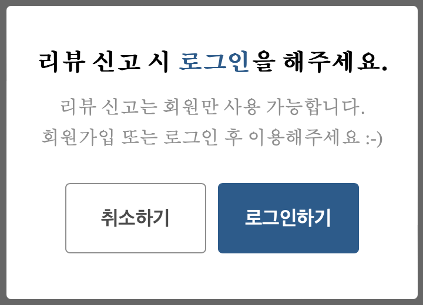
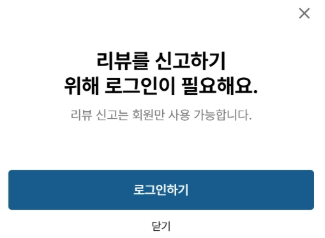
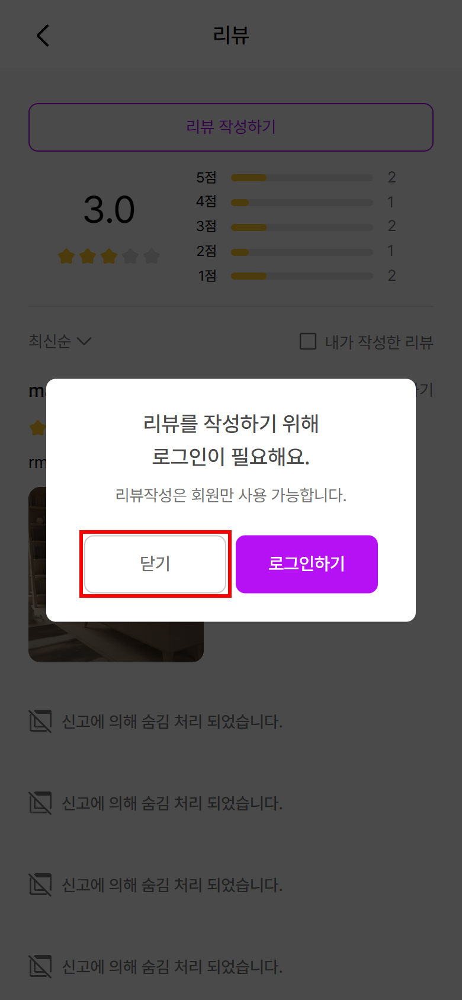
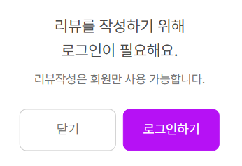

# 3-25 상점상세 리뷰신고 _취소누름  (비로그인) 

원문 페이지 ID: 4550221954bc8380846781c2d87c243a

> 원문 스냅샷. 명세 확정·앱 배포·수집 완료를 뜻하지 않습니다.

## 원문 속성

```json
{
  "platform": [
    "WEB",
    "ANDROID",
    "IOS"
  ],
  "url": "source-page-id:4550221954bc8380846781c2d87c243a",
  "상태": "완료",
  "생성일": "2026-11-08T10:51:49.523Z",
  "이벤트 이름": "<p>\n3-25 상점상세 리뷰신고 \\_취소누름  (비로그인) \n</p>",
  "태그": [
    "3. 상점 상세 페이지"
  ]
}
```

<details>
<summary>이전 로깅</summary>

<span color="orange">event\_params.key</span>

<ul>
<li>
event\_label : shop\_detail\_view\_review\_report\_cancel
</li>
<li>
value : \{상점이름\} 
</li>
<li>
event\_category : click
</li>
</ul>



---
</details>

<details>
<summary>새 로깅 (26.10.17)</summary>

- 설명: 로그인하지 않은 상태에서 리뷰 신고를 누르면 뜨는 로그인 안내 팝업에서 취소 버튼을 클릭하는 경우
- screen\_view: <code>shop_detail</code>
- event\_name: <code>DA1</code>
- event\_label: <code>account__shop_detail__login_popup__close__click</code>
- value: \{상점이름\} (예: 복지관 매점)
- event\_category: <code>click</code>

<details>
<summary>검토사항</summary>

- 모바일 웹 실화면 확인 (2026-10-30): 모바일 웹 신고 경로에서 리뷰 작성 문구의 공용 로그인 안내가 실제 표시됨을 확인하고 닫기 위치를 촬영했다. 문구를 이미지에서 고치지 않았고 기존 close 이벤트 계약은 유지한다. 네이티브 앱·SDK 전송은 별도 확인 대상이다.
- WEB 실화면 재검수 (2026-10-30): 실제 WEB 신고 로그인 안내의 닫기 위치를 확인했다. 현행 UI 표시는 닫기이며 기존 취소/close 응답 계약은 유지한다. 모바일의 리뷰 작성 팝업이 공용 UI인지 여부는 별도 확인 대상으로 남긴다. 로그인·신고 제출은 수행하지 않았다.
- 통합 가이드: [로깅 통합 가이드](3c30221954bc8214b1c481c5bbb6fba5.md)
- 명세 중복 정리 (2026-10-27): <code>account__shop_detail__login_popup__close__click</code>의 기준 명세는 [3-23 상점상세 리뷰작성 _로그인_취소  (클릭) ](fa00221954bc83c28c37814c683fb994.md). 리뷰 작성·신고 경로에서 같은 로그인 팝업 응답을 나타낸다. 같은 사용자 동작은 한 번만 전송하며, 문서가 여러 개라는 이유로 추가 이벤트를 보내지 않는다. 기존 value·플랫폼·발생 시점은 유지한다.
- label DA2 기준 정렬 (2026-10-27): <code>shop__shop_detail__review_report__login__cancel__click</code> → <code>account__shop_detail__login_popup__close__click</code>
</details>

### 참고사진 (비로그인 리뷰 신고 → 취소)

<columns>
<column ratio="50">
<b>웹</b>

<details>
<summary>참고사진 · 웹</summary>

<image source="assets/fcd03ec6-5bb4-468c-85bd-ca3a998174bd.png">
WEB · [koreatech.in](http://koreatech.in) 운영 사이트 비로그인 리뷰 신고 안내 → 닫기. 실제 신고 안내 문구를 확인했다. 빨간 테두리=닫기. 닉네임·리뷰 본문·연락처가 포함될 수 있는 영역은 검은색 마스킹.
</image>
</details>

<details>
<summary>교체 전 참고사진 · 웹 (이력)</summary>

웹 — 로그인 팝업 취소 클릭 (출처: 기존 캡처)


</details>
</column>
<column ratio="50">
<b>모바일</b>

<details>
<summary>참고사진 · 모바일</summary>

<image source="assets/b07adfd1-d05d-40e9-ad8d-0ae99a7d9af0.png">
모바일 웹 · 실제 신고하기를 눌러 열린 현행 보라색 로그인 안내의 닫기. 신고 경로에서도 리뷰 작성 문구가 표시됨을 확인했다. 빨간 테두리=닫기. 닉네임 검은색 마스킹.
</image>
</details>

<details>
<summary>기존 보라색 모바일 참고사진</summary>

모바일 — 로그인 팝업 취소 클릭 (출처: stage 실제 캡처, 빨간 네모 = 클릭 위치)




</details>
</column>
</columns>
</details>
