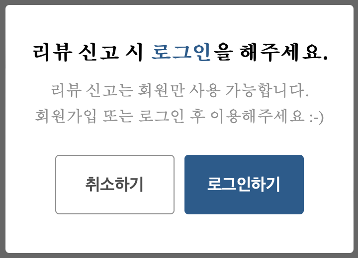

# 3-25 상점상세 리뷰신고 _취소누름  (비로그인) 

원문 페이지 ID: 4a20221954bc832da58181b5fede2885

> 원문 스냅샷. 명세 확정·앱 배포·수집 완료를 뜻하지 않습니다.

## 원문 속성

```json
{
  "platform": [
    "WEB",
    "ANDROID",
    "IOS"
  ],
  "url": "source-page-id:4a20221954bc832da58181b5fede2885",
  "상태": "완료",
  "생성일": "2026-11-12T05:07:37.627Z",
  "이벤트 이름": "<p>\n3-25 상점상세 리뷰신고 \\_취소누름  (비로그인) \n</p>",
  "태그": [
    "3. 상점 상세 페이지"
  ]
}
```

<details>
<summary>과거 로깅</summary>

<span color="orange">event\_params.key</span>

<ul>
<li>
event\_label : shop\_detail\_view\_review\_report\_cancel
</li>
<li>
value : \{상점이름\} 
</li>
<li>
event\_category : click
</li>
</ul>



---
</details>

<details>
<summary>새 로깅</summary>

- 설명: 로그인하지 않은 상태에서 리뷰 신고를 누르면 뜨는 로그인 안내 팝업에서 취소 버튼을 클릭하는 경우
- screen\_view: <code>shop_detail</code>
- event\_name: <code>DA2</code>
- event\_label: <code>account__shop_detail__login_popup__close__click</code>
- value: \{상점이름\} (예: 복지관 매점)
- event\_category: <code>click</code>

### 참고사진 (비로그인 리뷰 신고 → 취소)

<columns>
<column ratio="50">
<b>웹</b>

<b>참고사진 · 웹</b>

<image source="assets/fcd03ec6-5bb4-468c-85bd-ca3a998174bd.png">
WEB · [koreatech.in](http://koreatech.in) 운영 사이트 비로그인 리뷰 신고 안내 → 닫기. 실제 신고 안내 문구를 확인했다. 빨간 테두리=닫기. 닉네임·리뷰 본문·연락처가 포함될 수 있는 영역은 검은색 마스킹.
</image>
</column>
<column ratio="50">
<b>모바일</b>

<b>참고사진 · 모바일</b>

<image source="assets/b07adfd1-d05d-40e9-ad8d-0ae99a7d9af0.png">
모바일 웹 · 실제 신고하기를 눌러 열린 현행 보라색 로그인 안내의 닫기. 신고 경로에서도 리뷰 작성 문구가 표시됨을 확인했다. 빨간 테두리=닫기. 닉네임 검은색 마스킹.
</image>
</column>
</columns>
</details>
