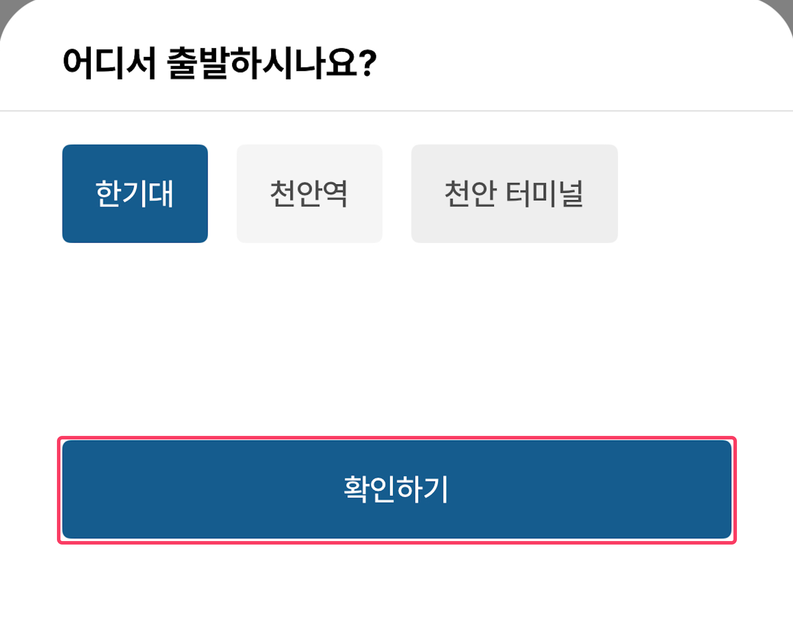

# 5-2. 출발지_확인_클릭

원문 페이지 ID: 4e60221954bc836892a381bf06d5747d

> 원문 스냅샷. 명세 확정·앱 배포·수집 완료를 뜻하지 않습니다.

## 원문 속성

```json
{
  "platform": [
    "ANDROID",
    "IOS",
    "WEB"
  ],
  "url": "source-page-id:4e60221954bc836892a381bf06d5747d",
  "구분": "출발지",
  "상태": "완료",
  "생성일": "2026-11-12T05:07:51.193Z",
  "이벤트 이름": "5-2. 출발지\\_확인\\_클릭",
  "태그": [
    "5. 교통편 조회하기"
  ]
}
```

<details>
<summary>과거 로깅</summary>

- 설명 : 출발지를 고르고 나서 선택하는 버튼
  - WEB의 경우 <span color="gray_bg">드롭다운</span>
- event\_label : “departure\_location\_confirm”
- value : “코리아텍”, “천안역”, “천안터미널<b>”</b>
- event\_category : “click”
- 참고사진



<image source="assets/96feda77-ec41-4ecf-be22-395b2b956fc9.png">
AND, IOS, WEB(Mobile view)
</image>

<image source="assets/29126682-3306-4143-808e-6ba4e1286fe5.png">
WEB
</image>
</details>

<details>
<summary>새 로깅</summary>

- 설명: 버스 교통편 화면에서 출발지를 고르고 확인하는 경우 (WEB은 드롭다운에서 선택)
- screen\_view: <code>bus_search</code>
- event\_name: <code>DA1</code>
- event\_label: <code>bus__bus_search__search__departure_confirm__select</code>
- value: 코리아텍 / 천안역 / 천안터미널 (예: 코리아텍)
- event\_category: <code>select</code>

### 참고사진 (기능 표시)

<columns>
<column ratio="50">
<b>웹</b>

<b>참고사진 · 웹</b>

<image source="assets/334f2b51-ce6f-4155-b294-d0c107389344.png">
WEB · 빨간 네모: 출발지 드롭다운에서 선택. stage 실제 화면 캡처에 위치 표시.
</image>
</column>
<column ratio="50">
<b>모바일</b>

<b>참고사진 · 모바일</b>

<image source="assets/6e5a71a8-664f-4981-97dd-91ef211bf9eb.png">
모바일 웹 · 운영 [https://koreatech.in/bus/route](https://koreatech.in/bus/route) 실제 파란색 화면을 2026-10-30에 캡처. 빨간 테두리: 출발지 드롭다운의 코리아텍 선택 항목. 현재 웹에는 별도 확인 버튼이 없다. Android/iOS 네이티브 앱 캡처가 아니며 SDK 발화·한 번 전송은 미확인.
</image>
</column>
</columns>
</details>
