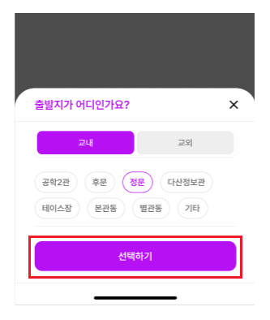
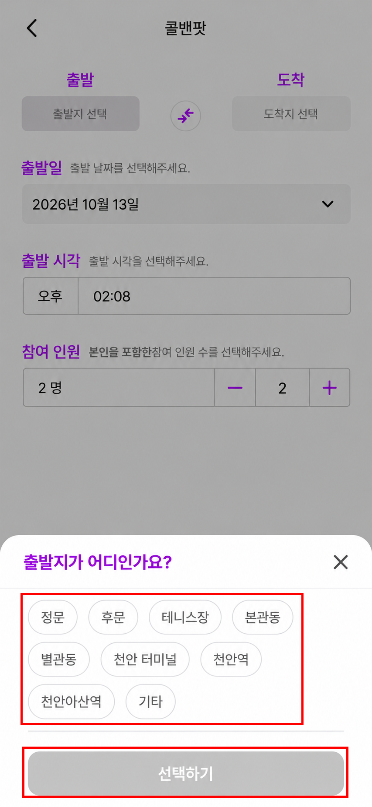

# 3-1 콜밴팟 출발지 선택

원문 페이지 ID: 54f0221954bc831cbf5f01457bce86ce

> 원문 스냅샷. 명세 확정·앱 배포·수집 완료를 뜻하지 않습니다.

## 원문 속성

```json
{
  "platform": [
    "ANDROID",
    "IOS"
  ],
  "url": "source-page-id:54f0221954bc831cbf5f01457bce86ce",
  "상태": "로깅 필요",
  "이름": "3-1 콜밴팟 출발지 선택",
  "태그": [
    "3. 콜밴팟 모집"
  ]
}
```

<details>
<summary>이전 로깅</summary>


- event\_name : CAMPUS
- event\_category : click
- event\_label : callvan\_write\_departure
- value
  - 예시 : 교내, 정문
  - 예시 : 교외, 천안 터미널
  - 예시 : 교내, 기타, 인문경영관





</details>

<details>
<summary>새 로깅 (2026-10-14) — 초안</summary>

- 설명: 모집글 작성 화면 위 출발지 선택 바텀시트에서 장소를 선택하고 선택하기를 클릭한다.
- screen\_view: <code>callvan_write</code>
- event\_label: <code>callvan__callvan_write__callvan_write__departure_confirm__click</code>
- event\_name: <code>DA2</code>
- value: - 예시 : 교내, 정문<br />- 예시 : 교외, 천안 터미널<br />- 예시 : 교내, 기타, 인문경영관
- event\_category: <code>click</code>
- 발생 시점 확정: 출발지 선택 바텀시트의 ‘선택하기’ 버튼을 누르는 순간, 최종 선택한 출발지를 기존 value 형식으로 전송한다. 장소 항목을 고르는 중에는 이 이벤트를 전송하지 않는다. 2026-10-15 Android에서 출발지 선택 바텀시트와 하단 ‘선택하기’ 버튼을 실제 확인했다.

<details>
<summary>검토사항</summary>

- label 통일 (2026-10-27): callvan\_\_callvan\_write\_\_callvan\_write\_\_departure\_confirm → callvan\_\_callvan\_write\_\_callvan\_write\_\_departure\_confirm\_\_click
</details>

### 참고사진 (기능 표시)

<b>모바일 (ANDROID, IOS) / 캡처 출처는 아래 참조</b>

<details>
<summary>참고사진 · 모바일</summary>

화면 정의의 Android 실제 캡처(2026-10-13), 선명도 개선본. 이번 작업은 기존 캡처를 사용. 추가 출발지 바텀시트 이미지.


</details>
</details>
