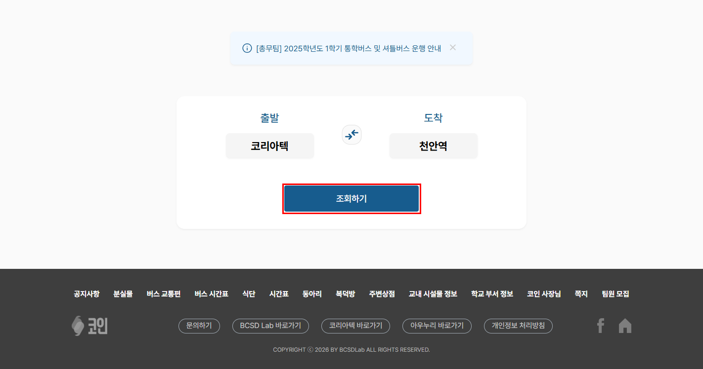

# 5-6. 조회하기_클릭

원문 페이지 ID: 5700221954bc82ca9bad014f97d43d13

> 원문 스냅샷. 명세 확정·앱 배포·수집 완료를 뜻하지 않습니다.

## 원문 속성

```json
{
  "platform": [
    "ANDROID",
    "IOS",
    "WEB"
  ],
  "url": "source-page-id:5700221954bc82ca9bad014f97d43d13",
  "상태": "완료",
  "생성일": "2026-11-08T10:51:38.127Z",
  "이벤트 이름": "5-6. 조회하기\\_클릭",
  "태그": [
    "5. 교통편 조회하기"
  ]
}
```

<details>
<summary>이전 로깅</summary>

- event\_label : “search\_bus”
- value : “조회하기<b>”</b>
- event\_category : “click”
- 참고사진

<image source="assets/a13eb8e7-bd84-4785-9cc7-58ec1eccc965.png">
AND, IOS, WEB(Mobile View)
</image>

<image source="assets/ebd546d8-cf69-49ca-8f06-86dacf7865e8.png">
WEB
</image>
</details>

<details>
<summary>새 로깅 (26.10.17)</summary>

- 설명: 버스 교통편 화면에서 조회하기를 클릭해 조회 결과 화면으로 들어가는 경우
- screen\_view: <code>bus_search</code>
- event\_name: <code>DA1</code>
- event\_label: <code>bus__bus_search__search__click</code>
- value: 조회하기
- event\_category: <code>click</code>

<details>
<summary>검토사항</summary>

- 통합 가이드: [로깅 통합 가이드](3c30221954bc8214b1c481c5bbb6fba5.md)
- 웹 사진은 stage 캡처(1422x748)를 유지한다. 모바일 칸은 2026-10-28 기존 모바일 참고사진 사본으로 보완했다. 현행 stage 모바일 웹은 출발·도착 선택 후 즉시 결과를 표시해 조회하기 버튼이 없으므로, 현행 적용 여부·앱 구현은 별도 확인한다.
</details>

### 참고사진 (기능 표시)

<columns>
<column ratio="50">
<b>웹</b>

<details>
<summary>참고사진 · 웹</summary>

웹 — 조회하기 클릭 (출처: stage 실제 캡처, 빨간 네모 = 클릭 위치)


</details>
</column>
<column ratio="50">
<b>모바일</b>

<details>
<summary>참고사진 · 모바일</summary>

기존 모바일 참고사진 사본 — 이전 로깅에서 ANDROID·IOS·WEB(Mobile View)로 명시된 이미지. 빨간 네모 = 조회하기 버튼. 현행 stage 반응형 웹은 출발·도착 선택 후 즉시 결과를 표시하므로 이 사진을 현행 웹 캡처나 현행 앱 구현 검증으로 사용하지 않는다.

파란색 구버전 모바일 사진 제거 (2026-10-30).
</details>
</column>
</columns>
</details>
