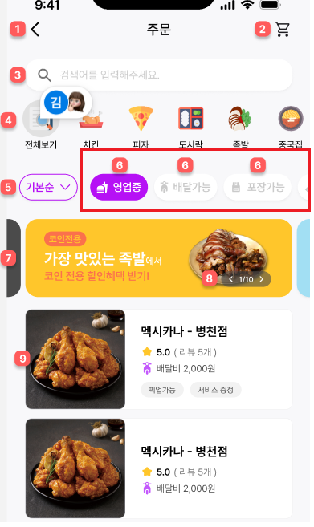

# 2-13 ~ 17 상점 카테고리 필터

원문 페이지 ID: 6310221954bc83dca6440164777974e2

> 원문 스냅샷. 명세 확정·앱 배포·수집 완료를 뜻하지 않습니다.

## 원문 속성

```json
{
  "platform": [
    "ANDROID",
    "IOS",
    "WEB (모바일)"
  ],
  "url": "source-page-id:6310221954bc83dca6440164777974e2",
  "상태": "로깅 필요",
  "생성일": "2026-11-12T05:07:36.736Z",
  "이벤트 이름": "2-13 \\~ 17 상점 카테고리 필터",
  "태그": [
    "2. 상점 카테고리"
  ]
}
```

<details>
<summary>과거 로깅</summary>

기존 기능 및 디자인 → 로깅 수정 및 추가(오른쪽 사진)

<columns>
<column ratio="50">

</column>
<column ratio="50">



</column>
</columns>

<columns>
<column ratio="50">
<span color="orange">event\_params.key</span>

<ul>
<li>
event\_label : shop\_can
</li>
<li>
value : 

- check\_delivery\_\{카테고리\}
- check\_open\_\{카테고리\}
</li>
<li>
event\_category : click 
</li>
</ul>
</column>
<column ratio="50">
- 영업중
- 배달가능
- 포장가능
- 배달팁무료
- 최소주문금액


<span color="orange">event\_params.key</span>

<ul>
<li>
event\_label : shop\_can
</li>
<li>
value : 

- check\_open\_\{카테고리\}
- check\_delivery\_\{카테고리\}
- check\_takeout\_\{카테고리\}
- check\_free\_delivery\_\{카테고리\}
- check\_min\_amount\_\{카테고리\}
</li>
<li>
event\_category : click 
</li>
</ul>
</column>
</columns>

---


메인화면이 아니면 주변상점 view인 경우, 영업중만 심어주시면 됩니다 !


<span color="orange">event\_params.key</span>

<ul>
<li>
event\_label : shop\_can
</li>
<li>
value : 

- check\_open\_\{카테고리\}
</li>
<li>
event\_category : click 
</li>
</ul>
</details>

<details>
<summary>새 로깅</summary>

- 설명: 상점 목록의 영업중·배달가능·포장가능·배달팁무료 토글은 해제 상태에서 선택 상태로 바뀔 때 1회 기록하고, 끌 때는 기록하지 않는다. 최소주문금액은 토글과 구분하며 기존 설정 버튼을 눌러 설정창을 여는 시점을 유지한다.
- screen\_view: <code>shop_list</code>
- event\_name: <code>DA1</code>
- event\_label: <code>shop__shop_list__filter__quick_filter__select</code>
- value: \{켠 필터\} → 영업중 / 배달가능 / 포장가능 / 배달팁무료 / 최소주문금액 (예: 영업중)
- event\_category: <code>select</code>

### 참고사진 (필터 켜기)

<columns>
<column ratio="50">
<b>웹</b>

<b>참고사진 · 웹</b>

해당 없음 (PC 웹은 2-5\~8 체크박스와 같은 라벨 사용)
</column>
<column ratio="50">
<b>모바일</b>

<b>참고사진 · 모바일</b>

<image source="assets/e1d2820a-fc08-40d5-bb0c-34ea0769a7de.png">
모바일 웹 · 2026-10-30 운영 보라색 상점 목록의 영업중 필터. 빨간 테두리=영업중 버튼. 이 화면에서는 영업중만 확인했고 배달가능·포장가능·배달팁무료·최소주문금액 및 네이티브 앱 지원·SDK 발화는 미확인이다.
</image>
</column>
</columns>
</details>
