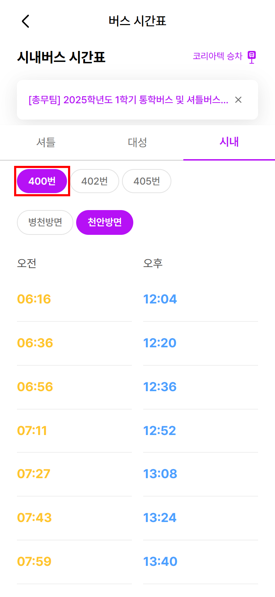

# 4-10. 시내버스 노선_클릭

원문 페이지 ID: 6320221954bc823c94e9013b95c6619d

> 원문 스냅샷. 명세 확정·앱 배포·수집 완료를 뜻하지 않습니다.

## 원문 속성

```json
{
  "platform": [
    "ANDROID",
    "IOS",
    "WEB"
  ],
  "url": "source-page-id:6320221954bc823c94e9013b95c6619d",
  "구분": "시내버스 시간표",
  "상태": "완료",
  "생성일": "2026-11-08T10:51:38.636Z",
  "이벤트 이름": "4-10. 시내버스 노선\\_클릭",
  "태그": [
    "4. 버스 시간표"
  ]
}
```

<details>
<summary>이전 로깅</summary>

- event\_label : “city\_bus\_route”
- value : “OOO번<b>”</b>
  - 400, 405, 495 (24-12-15 기준)
- event\_category : “click”
- 참고사진

<image source="assets/95678f38-8bc5-4bf9-8efb-a78e81087e9a.png">
AND, IOS, WEB(Mobile view)
</image>

<image source="assets/bbfb49fb-1882-4340-8612-a00d327549c0.png">
WEB
</image>
</details>

<details>
<summary>새 로깅 (26.10.17)</summary>

- 설명: 버스 시간표 화면 시내 탭에서 버스 노선 번호를 선택하는 경우
- screen\_view: <code>bus_timetable</code>
- event\_name: <code>DA1</code>
- event\_label: <code>bus__bus_timetable__filter__city_route__select</code>
- value: \{버스 번호\}번 (예: 400번, 405번, 495번)
- event\_category: <code>select</code>

<details>
<summary>검토사항</summary>

- 통합 가이드: [로깅 통합 가이드](3c30221954bc8214b1c481c5bbb6fba5.md)
- 웹/모바일 참고사진 추가 완료 (stage 캡처에 빨간 네모, 2026-10-28).
- label DA2 기준 정렬 (2026-10-27): <code>bus__bus_timetable__city_route__select</code> → <code>bus__bus_timetable__filter__city_route__select</code>
</details>

### 참고사진 (기능 표시)

<columns>
<column ratio="50">
<b>웹</b>

<details>
<summary>참고사진 · 웹</summary>

<image source="assets/98b53485-99b4-4ec9-8f84-1b8b6496464d.png">
WEB · 빨간 네모: 시내버스 노선 번호 선택. stage 실제 화면 캡처에 위치 표시.
</image>
</details>
</column>
<column ratio="50">
<b>모바일</b>

<details>
<summary>참고사진 · 모바일</summary>

모바일 — 시내버스 노선 선택 (출처: stage 실제 캡처, 빨간 네모 = 클릭 위치)


</details>
</column>
</columns>
</details>
