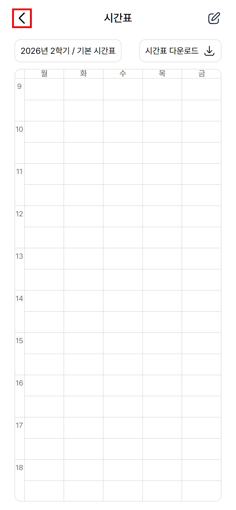

# 2-10. 시간표 탈출_뒤로가기버튼

원문 페이지 ID: 8080221954bc82049a9301709f7bba9e

> 원문 스냅샷. 명세 확정·앱 배포·수집 완료를 뜻하지 않습니다.

## 원문 속성

```json
{
  "platform": [
    "ANDROID",
    "IOS"
  ],
  "url": "source-page-id:8080221954bc82049a9301709f7bba9e",
  "상태": "완료",
  "생성일": "2026-11-08T10:52:13.163Z",
  "이벤트 이름": "2-10. 시간표 탈출\\_뒤로가기버튼",
  "태그": [
    "시간표"
  ]
}
```

<details>
<summary>이전 로깅</summary>

- event\_label : “timetable\_back”
- value : “뒤로가기버튼”
- event\_category : “click”
</details>

<details>
<summary>새 로깅 (26.10.17)</summary>

- 설명: 모바일 시간표 화면 왼쪽 위 뒤로가기(\<) 버튼을 눌러 시간표에서 나가는 경우
- screen\_view: <code>timetable</code>
- event\_name: <code>DA1</code>
- event\_label: <code>timetable__timetable__navigation__back__click</code>
- value: 뒤로가기
- event\_category: <code>click</code>

<details>
<summary>검토사항</summary>

- 통합 가이드·후속: [로깅 통합 가이드](3c30221954bc8214b1c481c5bbb6fba5.md)
- 웹: 없음
- label DA2 기준 정렬 (2026-10-27): <code>timetable__timetable__back__click</code> → <code>timetable__timetable__navigation__back__click</code>
</details>

### 참고사진 (기능 표시)

<columns>
<column ratio="50">
<b>웹</b>

<details>
<summary>참고사진 · 웹</summary>

해당 없음 (모바일 전용)
</details>
</column>
<column ratio="50">
<b>모바일</b>

<details>
<summary>참고사진 · 모바일</summary>

모바일 — 뒤로가기 버튼 (출처: stage 실제 캡처, 빨간 네모 = 클릭 위치)


</details>
</column>
</columns>
</details>
