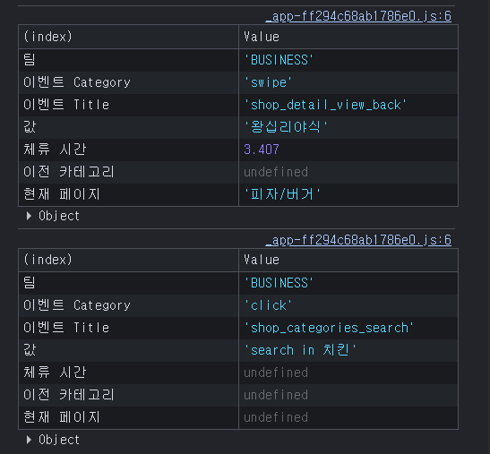

# 2-4 상점카테고리 검색 (클릭) 

원문 페이지 ID: 8230221954bc837f814981aa3e389deb

> 원문 스냅샷. 명세 확정·앱 배포·수집 완료를 뜻하지 않습니다.

## 원문 속성

```json
{
  "platform": [
    "WEB",
    "ANDROID",
    "IOS"
  ],
  "url": "source-page-id:8230221954bc837f814981aa3e389deb",
  "상태": "완료",
  "생성일": "2026-11-08T10:51:49.890Z",
  "이벤트 이름": "<p>\n2-4 상점카테고리 검색 (클릭) \n</p>",
  "태그": [
    "2. 상점 카테고리"
  ]
}
```

<details>
<summary>이전 로깅</summary>

<span color="orange">event\_params.key</span>

<ul>
<li>
event\_label : shop\_categories\_search
</li>
<li>
value : search in \{카테고리\}
</li>
<li>
event\_category : click 
</li>
</ul>

---

<p>
이후 검색이 통합될 경우 다시 만져야함. 
</p>

---

### 오류사항

[해결 (1)](04d0221954bc8349ba63017073c183ed.md)
</details>

<details>
<summary>새 로깅 (26.10.17)</summary>

- 설명: 상점 목록 화면에서 주변상점 카테고리를 선정하고 검색 창으로 들어가는 경우
- screen\_view: <code>shop_list</code>
- event\_name: <code>DA1</code>
- event\_label: <code>shop__shop_list__search__click</code>
- value: \{현재 카테고리\} → 전체보기 / 치킨 / 피자/버거 등 (예: 치킨)
- event\_category: <code>click</code>

<details>
<summary>검토사항</summary>

- 사진 재검수 (2026-10-30): 콘솔 없는 WEB 검색창을 대표 사진으로 교체했다. 이전 UI·콘솔 자료는 검수 근거 이력으로 보존했다. 운영 /store?category=1 보라색 모바일 웹의 검색 진입 버튼을 직접 확인하고 사진을 보완했다. 네이티브 앱·SDK 발화는 미확인이다.
- label DA2 형식 검수 (2026-10-28): 현행 <code>shop__shop_list__search__click</code>. 공용 기능 search와 기존 category click을 사용하는 4구간 형식으로 이미 정렬되어 있어 라벨을 유지한다. 현재 카테고리 value와 검색창 진입 시점을 유지한다. 이 메모 추가로 라벨·value·사진은 변경하지 않는다. SDK/dbt 반영·실제 전송·한 번 전송은 미확인이다.
- 통합 가이드: [로깅 통합 가이드](3c30221954bc8214b1c481c5bbb6fba5.md)

<details>
<summary>과거 콘솔 로그 · 보조 증빙 (UI 대표사진 아님)</summary>

검색 진입 로깅의 과거 콘솔 자료다. 현재 화면 캡처·현행 SDK 검증 완료 근거로 쓰지 않으며 원문 이미지는 보존한다.


</details>
</details>

### 참고사진 (검색 창 진입)

<columns>
<column ratio="50">
<b>웹</b>

<details>
<summary>참고사진 · 웹</summary>

<image source="assets/a11249e8-dd00-4453-988e-5f9eebd10e98.png">
WEB · stage 실제 검색창 진입. 빨간 테두리=명세 대상. 콘솔 없음. 2026-10-30.
</image>
</details>
</column>
<column ratio="50">
<b>모바일</b>

<details>
<summary>참고사진 · 모바일</summary>

<image source="assets/34e3c33c-32e4-48c7-a7bb-7c34d12ded93.png">
모바일 웹 · 2026-10-30 운영 보라색 주변상점 목록. 빨간 테두리=검색 화면으로 진입하는 검색 버튼. 썸네일의 연락처 가능 영역은 검은색 마스킹. 네이티브 앱·SDK 발화는 미확인이다.
</image>
</details>
</column>
</columns>
</details>
