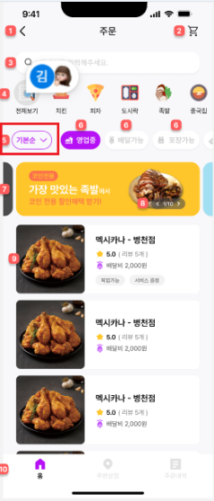
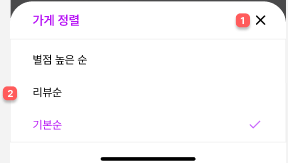

# 2-10~12 상점 카테고리 정렬 

원문 페이지 ID: 8f80221954bc83a3bc058190de9f45a9

> 원문 스냅샷. 명세 확정·앱 배포·수집 완료를 뜻하지 않습니다.

## 원문 속성

```json
{
  "platform": [
    "ANDROID",
    "IOS"
  ],
  "url": "source-page-id:8f80221954bc83a3bc058190de9f45a9",
  "상태": "로깅 필요",
  "생성일": "2026-11-08T10:51:51.531Z",
  "이벤트 이름": "<p>\n2-10\\~12 상점 카테고리 정렬 \n</p>",
  "태그": [
    "2. 상점 카테고리"
  ]
}
```

<details>
<summary>이전 로깅</summary>

기존 기능 및 디자인 → 로깅 수정 및 추가(오른쪽 사진)

<columns>
<column ratio="50">


</column>
<column ratio="50">



</column>
</columns>

<columns>
<column ratio="50">
<span color="orange">event\_params.key</span>

<ul>
<li>
event\_label : shop\_can
</li>
<li>
value : 

- check\_delivery\_\{카테고리\}
- check\_review\_\{카테고리\}
- check\_star\_\{카테고리\}
- check\_open\_\{카테고리\}
</li>
<li>
event\_category : click 
</li>
</ul>
</column>
<column ratio="50">
<span color="orange">event\_params.key</span>

<ul>
<li>
event\_label : shop\_can
</li>
<li>
value : 

- check\_default\_\{카테고리\}
- check\_review\_\{카테고리\}
- check\_star\_\{카테고리\}
</li>
<li>
event\_category : click 
</li>
</ul>
</column>
</columns>


---


메인화면이 아닌 주변상점 view의 경우에도 동일하게

로깅 심어주시면 됩니다 !


<span color="orange">event\_params.key</span>

<ul>
<li>
event\_label : shop\_can
</li>
<li>
value : 

- check\_default\_\{카테고리\}
- check\_review\_\{카테고리\}
- check\_star\_\{카테고리\}
</li>
<li>
event\_category : click 
</li>
</ul>
</details>

<details>
<summary>새 로깅 (26.10.17)</summary>

- 설명: 상점 목록 화면에서 정렬 버튼(기본순)을 눌러 정렬 방식을 고르는 경우
- screen\_view: <code>shop_list</code>
- event\_name: <code>DA1</code>
- event\_label: <code>shop__shop_list__filter__sort__select</code>
- value: \{정렬\} → 기본순 / 리뷰순 / 별점 높은 순 (예: 리뷰순)
- event\_category: <code>select</code>

<details>
<summary>검토사항</summary>

- 통합 가이드: [로깅 통합 가이드](3c30221954bc8214b1c481c5bbb6fba5.md)
- 웹: 없음 (PC 웹의 필터 체크박스는 2-5\~8의 현행 <code>shop__shop_list__filter__checkbox__select</code>를 참조한다. 이 페이지의 <code>shop__shop_list__filter__sort__select</code> 정렬 선택과 구분한다.)
- label DA2 기준 정렬 (2026-10-27): <code>shop__shop_list__sort__select</code> → <code>shop__shop_list__filter__sort__select</code>
</details>

### 참고사진 (정렬 선택)

<columns>
<column ratio="50">
<b>웹</b>

<details>
<summary>참고사진 · 웹</summary>

해당 없음 (PC 웹은 필터 체크박스 사용, 2-5\~8 참고)
</details>
</column>
<column ratio="50">
<b>모바일</b>

<details>
<summary>참고사진 · 모바일</summary>

<image source="assets/70e42e89-05c9-4242-bd2e-474c320c1a0f.png">
모바일 웹 · 2026-10-30 운영 /store?category=1 보라색 리디자인 실제 정렬 선택창. 빨간 테두리=별점 높은 순·리뷰순·기본순 선택 영역. 배경 썸네일의 연락처 가능 영역은 검은색 마스킹. 네이티브 앱과 SDK 발화는 미확인이다.
</image>
</details>
</column>
</columns>
</details>
