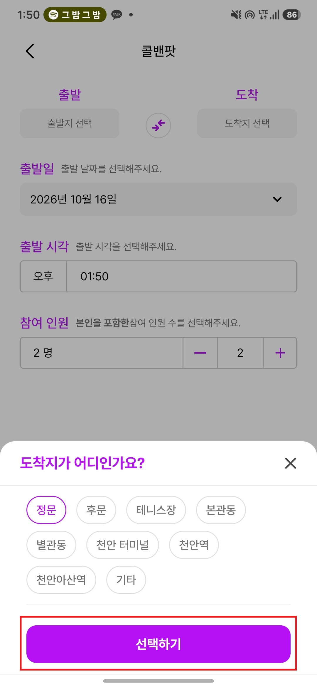

# 3-2 콜밴팟 도착지 선택

원문 페이지 ID: 99b0221954bc82af996e01beb7f602d0

> 원문 스냅샷. 명세 확정·앱 배포·수집 완료를 뜻하지 않습니다.

## 원문 속성

```json
{
  "platform": [
    "ANDROID",
    "IOS"
  ],
  "url": "source-page-id:99b0221954bc82af996e01beb7f602d0",
  "상태": "로깅 필요",
  "이름": "3-2 콜밴팟 도착지 선택",
  "태그": [
    "3. 콜밴팟 모집"
  ]
}
```

<details>
<summary>이전 로깅</summary>


- event\_name : CAMPUS
- event\_category : click
- event\_label : callvan\_write\_arrival
- value :
  - 예시 : 교내, 정문
  - 예시 : 교외, 천안 터미널
  - 예시 : 교내, 기타, 인문경영관


</details>

<details>
<summary>새 로깅 (2026-10-14) — 초안</summary>

- 설명: 모집글 작성 화면 위 도착지 선택 바텀시트에서 장소를 선택하고 선택하기를 클릭한다.
- screen\_view: <code>callvan_write</code>
- event\_label: <code>callvan__callvan_write__callvan_write__arrival_confirm__click</code>
- event\_name: <code>DA2</code>
- value: - 예시 : 교내, 정문<br />- 예시 : 교외, 천안 터미널<br />- 예시 : 교내, 기타, 인문경영관
- event\_category: <code>click</code>

<details>
<summary>검토사항</summary>

- 통합 가이드·후속: [로깅 통합 가이드](3c30221954bc8214b1c481c5bbb6fba5.md)
- label 통일 (2026-10-27): callvan\_\_callvan\_write\_\_callvan\_write\_\_arrival\_confirm → callvan\_\_callvan\_write\_\_callvan\_write\_\_arrival\_confirm\_\_click
- 확정 (2026-10-16): 도착지 바텀시트의 ‘선택하기’ 버튼을 누르는 순간 최종 선택 장소를 전송한다. 개별 장소를 고르는 중에는 전송하지 않는다. 기존 장소 value와 category는 유지한다.
- 도착지 참고사진은 사용자가 실제 화면으로 교체 완료했다(2026-10-16). 현재 첨부 이미지를 유지한다.
</details>

### 참고사진 (기능 표시)

<b>모바일 (ANDROID, IOS) / 캡처 출처는 아래 참조</b>

<details>
<summary>참고사진 · 모바일</summary>


</details>
</details>
