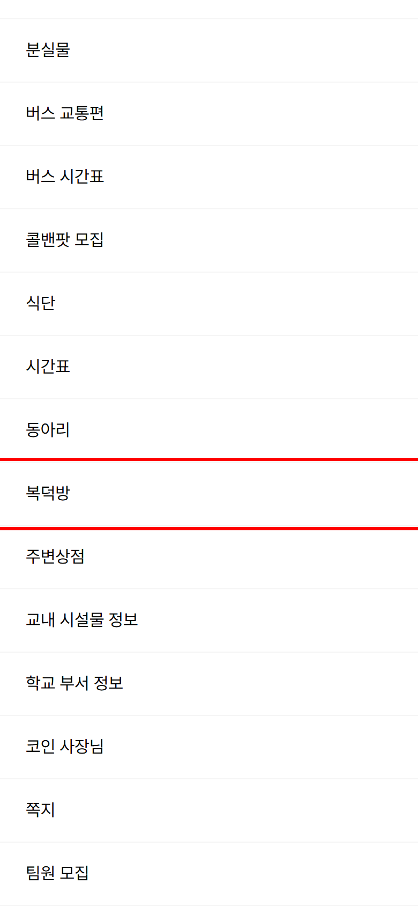

# 1-3 햄버거_복덕방 진입 (클릭)

원문 페이지 ID: 9a60221954bc826a9ac60157bd796900

> 원문 스냅샷. 명세 확정·앱 배포·수집 완료를 뜻하지 않습니다.

## 원문 속성

```json
{
  "platform": [
    "WEB"
  ],
  "url": "source-page-id:9a60221954bc826a9ac60157bd796900",
  "상태": "완료",
  "생성일": "2026-11-08T10:51:50.763Z",
  "이벤트 이름": "1-3 햄버거\\_복덕방 진입 (클릭)"
}
```

<details>
<summary>이전 로깅</summary>

<span color="orange">event\_params.key</span>

<ul>
<li>
event\_label : hamburger
</li>
<li>
value : 복덕방 
</li>
<li>
event\_category : click <br />
</li>
</ul>
</details>

<details>
<summary>새 로깅 (26.10.17)</summary>

- 설명: 모바일 웹 상단 메뉴(☰)에서 복덕방을 클릭해 복덕방 목록 화면으로 들어가는 경우
- screen\_view: <code>main_category</code>
- event\_name: <code>DA1</code>
- event\_label: <code>real_estate__main_category__real_estate_entry__category_entry__click</code>
- value: 복덕방
- event\_category: <code>click</code>

<details>
<summary>검토사항</summary>

- 통합 가이드: [로깅 통합 가이드](3c30221954bc8214b1c481c5bbb6fba5.md)
- 모바일 앱 카테고리 진입은 이미 [1-4 카테고리_복덕방 진입 (클릭) - 추가된 로깅](3460221954bc821ba40201902750e7d8.md)에 작성되어 있다. 이 페이지는 모바일 웹 메뉴 경로의 대응 설명이다. 공통 라벨은 기존 동일 이벤트 계약표를 따르며 별도 진입 라벨 신설 제안은 철회한다. 실제 플랫폼별 호출·한 번 전송은 미확인이다.
- label DA2 기준 정렬 (2026-10-27): <code>real_estate__hamburger__real_estate_entry__category_entry__click</code> → <code>real_estate__main_category__real_estate_entry__category_entry__click</code>
- 명세 중복 정리 (2026-10-27): <code>real_estate__main_category__real_estate_entry__category_entry__click</code>의 기준 명세는 [1-4 카테고리_복덕방 진입 (클릭) - 추가된 로깅](3460221954bc821ba40201902750e7d8.md). 서비스 진입 목적은 같고 웹 메뉴·앱 카테고리 등 플랫폼별 경로는 각 원문을 따른다. 같은 사용자 동작은 한 번만 전송하며, 문서가 여러 개라는 이유로 추가 이벤트를 보내지 않는다. 기존 value·플랫폼·발생 시점은 유지한다.
- 화면명 정렬 (2026-10-27): 카테고리 고정 화면명 main\_category와 라벨의 페이지 구간을 일치시켰다. 플랫폼별 진입 경로와 플랫폼 속성은 원문대로 유지한다.
- label DA2 기준 정렬 (2026-10-27): <code>real_estate__hamburger__entry__click</code> → <code>real_estate__hamburger__real_estate_entry__category_entry__click</code>
- 사진 플랫폼 확인 완료 (이미지 비율 기준: 모바일, 780x1688): 이 로깅은 모바일 웹 메뉴(웹 로깅)인데 사진 파일명이 re\_hamburger\_mobile이라 모바일 칸에 둔 것이 맞다. 웹 참고사진 추가 완료
</details>

### 참고사진 (모바일 웹 햄버거 메뉴)

<columns>
<column ratio="50">
<b>웹</b>

<details>
<summary>참고사진 · 웹</summary>

<image source="assets/4c2c7d53-16ac-473f-9e2c-25a1e170968d.png">
WEB (모바일) · 빨간 네모: 모바일 웹 상단 메뉴의 복덕방 항목. stage 실제 화면 캡처에 위치 표시.
</image>
</details>
</column>
<column ratio="50">
<b>모바일</b>

<details>
<summary>참고사진 · 모바일</summary>

모바일 — 햄버거 메뉴 복덕방 (출처: stage 실제 캡처, 빨간 네모 = 클릭 위치)


</details>
</column>
</columns>
</details>
