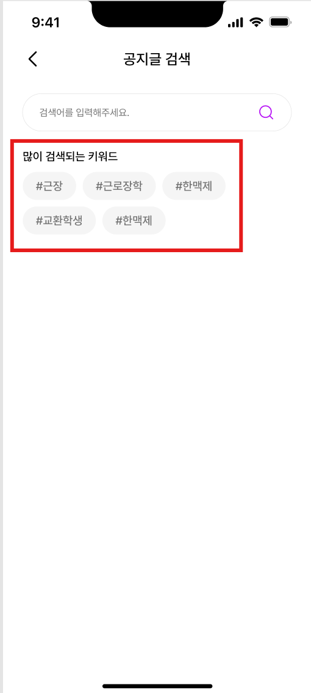

# 6-2. 많이 검색되는 키워드_클릭

원문 페이지 ID: aca0221954bc82c1b591815722e03b52

> 원문 스냅샷. 명세 확정·앱 배포·수집 완료를 뜻하지 않습니다.

## 원문 속성

```json
{
  "platform": [
    "ANDROID",
    "IOS"
  ],
  "url": "source-page-id:aca0221954bc82c1b591815722e03b52",
  "상태": "로깅 필요",
  "이름": "6-2. 많이 검색되는 키워드\\_클릭",
  "태그": [
    "6. 공지글 검색(APP)"
  ]
}
```

<details>
<summary>과거 로깅</summary>

<image source="assets/89a78c1c-cce2-4ace-b2d0-55dc7f71f7cc.png">
키워드를 value값으로 추가
</image>


</details>

<details>
<summary>새 로깅</summary>

- 설명: 공지글 검색 화면에서 많이 검색되는 키워드 선택.
- screen\_view: <code>notice_search</code>
- event\_name: <code>DA2</code>
- event\_label: <code>board__notice_search__search__popular_keyword__select</code>
- value: \{선택한 키워드\}
- event\_category: <code>select</code>

<b>참고사진 · 모바일</b>

<b>모바일</b>


</details>
