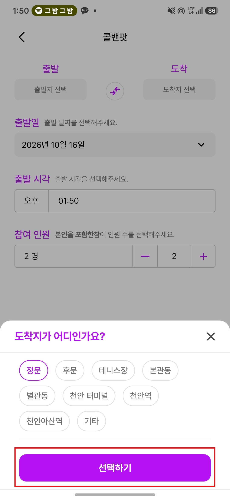

# 3-2 콜밴팟 도착지 선택

원문 페이지 ID: b790221954bc8365a0d3811f1c79910b

> 원문 스냅샷. 명세 확정·앱 배포·수집 완료를 뜻하지 않습니다.

## 원문 속성

```json
{
  "platform": [
    "ANDROID",
    "IOS"
  ],
  "url": "source-page-id:b790221954bc8365a0d3811f1c79910b",
  "상태": "로깅 필요",
  "이름": "3-2 콜밴팟 도착지 선택",
  "태그": [
    "3. 콜밴팟 모집"
  ]
}
```

<details>
<summary>과거 로깅</summary>


- event\_name : CAMPUS
- event\_category : click
- event\_label : callvan\_write\_arrival
- value :
  - 예시 : 교내, 정문
  - 예시 : 교외, 천안 터미널
  - 예시 : 교내, 기타, 인문경영관


</details>

<details>
<summary>새 로깅</summary>

- 설명: 모집글 작성 화면 위 도착지 선택 바텀시트에서 장소를 선택하고 선택하기를 클릭한다.
- screen\_view: <code>callvan_write</code>
- event\_label: <code>callvan__callvan_write__callvan_write__arrival_confirm__click</code>
- event\_name: <code>DA2</code>
- value: - 예시 : 교내, 정문<br />- 예시 : 교외, 천안 터미널<br />- 예시 : 교내, 기타, 인문경영관
- event\_category: <code>click</code>

### 참고사진 (기능 표시)

<b>모바일 (ANDROID, IOS) / 캡처 출처는 아래 참조</b>

<b>참고사진 · 모바일</b>


</details>
