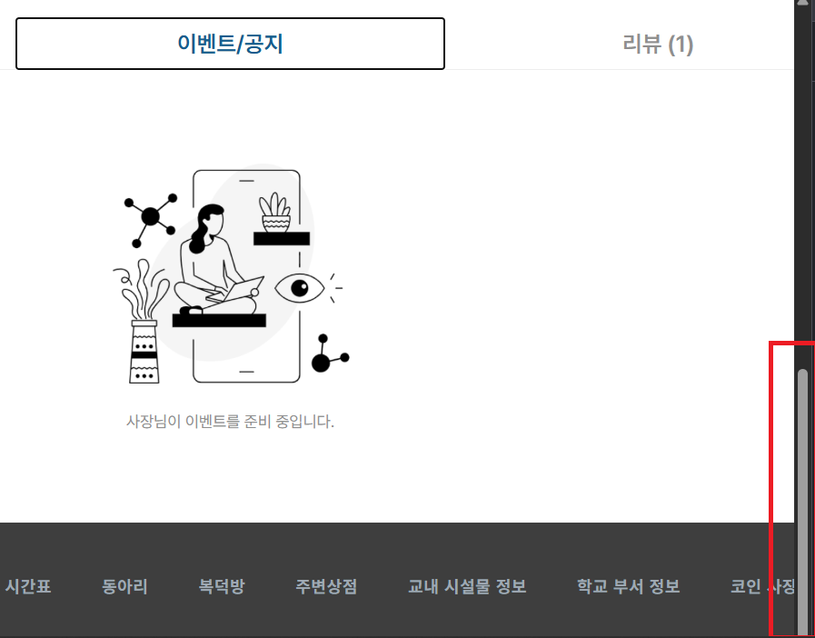

# 3-9 상점상세 이벤트 (스크롤) 

원문 페이지 ID: c3e0221954bc82fe9ede010d8798f66d

> 원문 스냅샷. 명세 확정·앱 배포·수집 완료를 뜻하지 않습니다.

## 원문 속성

```json
{
  "platform": [
    "WEB",
    "ANDROID",
    "IOS"
  ],
  "url": "source-page-id:c3e0221954bc82fe9ede010d8798f66d",
  "상태": "완료",
  "생성일": "2026-11-08T10:51:50.648Z",
  "이벤트 이름": "<p>\n3-9 상점상세 이벤트 (스크롤) \n</p>",
  "태그": [
    "3. 상점 상세 페이지"
  ]
}
```

<details>
<summary>이전 로깅</summary>

<span color="orange">event\_params.key</span>

<ul>
<li>
event\_label : shop\_detail\_view\_event
</li>
<li>
value : \{상점이름\} 
</li>
<li>
event\_category : scroll
</li>
</ul>


### 오류사항

<p>
안드 
</p>

<ol>
<li>
스크롤 안되는 이슈 
</li>
</ol>
</details>

<details>
<summary>새 로깅 (26.10.17)</summary>

- 설명: 상점 상세 화면에서 가게의 이벤트(진행 중인 혜택·이벤트 영역)를 스크롤하는 경우
- screen\_view: <code>shop_detail</code>
- event\_name: <code>DA1</code>
- event\_label: <code>shop__shop_detail__shop_event__scroll</code>
- value: \{상점이름\} (예: 복지관 매점)
- event\_category: <code>scroll</code>

<details>
<summary>검토사항</summary>

- 모바일 웹 실화면 확인 (2026-10-30): 파란색 모바일 사진을 제거한 자리에 현재 보라색 모바일 웹 이벤트/공지 목록을 보완했다. 등록 카드가 1개라 사진은 대상 영역 참고자료이며 내부 스크롤 동작·SDK 발화는 미확인이다.
- WEB 실화면 재검수 (2026-10-30): 운영 사이트의 73개 상점 공개 목록에서 이벤트 등록 표시가 있는 세븐일레븐 한기대점·왕십리야식 2곳을 확인하고, 배달 혜택 이벤트가 등록된 왕십리야식을 대표로 촬영했다. 등록 기간은 2026-06-24\~2026-11-30. 현재 카드는 1개이므로 이 사진만으로 내부 스크롤 발생·SDK 수집을 확정하지 않는다. 이전 stage 사진은 이력으로 보존한다.
- label DA2 기준 정렬 (2026-10-27): <code>shop__shop_detail__event__scroll</code> → <code>shop__shop_detail__shop_event__scroll</code> / 통합 가이드: [로깅 통합 가이드](3c30221954bc8214b1c481c5bbb6fba5.md)
- 사진 정정 (2026-10-30): WEB 대표사진을 빈 상태의 탭 표시에서 실제 이벤트 카드가 있는 목록 영역 표시로 교체했다. 정적 사진의 대상 영역 보정이며 실제 스크롤·SDK 발화 검증 완료를 뜻하지 않는다.
</details>

### 참고사진 (상점 상세 이벤트 스크롤)

<columns>
<column ratio="50">
<b>웹</b>

<details>
<summary>참고사진 · 웹</summary>


</details>
</column>
<column ratio="50">
<b>모바일</b>

<details>
<summary>참고사진 · 모바일</summary>


<image source="assets/46b85762-9fe1-4963-80c3-cd50599fe176.png">
모바일 웹 · 운영 왕십리야식의 보라색 리디자인 이벤트/공지 목록. 빨간 테두리=실제 이벤트 카드 목록. 현재 1개 카드이며 실제 스크롤 발생·SDK 전송 검증과 구분한다.
</image>

구버전 모바일 사진을 제거하고 현행 보라색 모바일 웹 사진으로 보완했다.


</details>
</column>
</columns>
</details>


