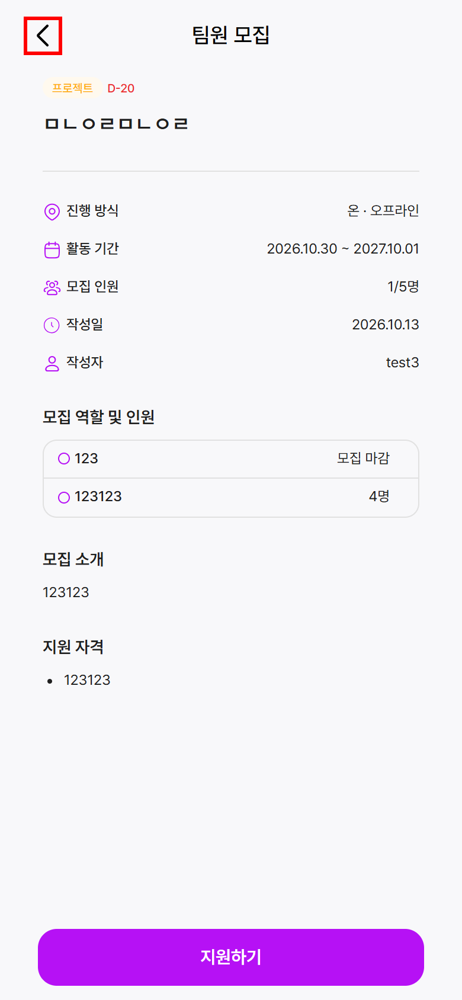

# 4-3. 모집글 상세_뒤로가기 (클릭) - 추가된 로깅

원문 페이지 ID: c8e0221954bc83c9b38881d86e381fb5

> 원문 스냅샷. 명세 확정·앱 배포·수집 완료를 뜻하지 않습니다.

## 원문 속성

```json
{
  "platform": [
    "ANDROID",
    "IOS"
  ],
  "url": "source-page-id:c8e0221954bc83c9b38881d86e381fb5",
  "구분": "모집글 상세 지원자",
  "상태": "로깅 필요",
  "생성일": "2026-11-12T05:08:06.610Z",
  "이벤트 이름": "4-3. 모집글 상세\\_뒤로가기 (클릭) - 추가된 로깅"
}
```

<details>
<summary>과거 로깅</summary>

- 없음 (새로 추가한 로깅)
</details>

<details>
<summary>새 로깅</summary>

- 설명: 모집글 상세 화면 왼쪽 위 뒤로가기(\<) 버튼을 클릭해 이전 화면(팀원 모집 목록 등)으로 돌아가는 경우
- screen\_view: <code>team_detail</code>
- event\_name: <code>DA1</code>
- event\_label: <code>team_recruit__team_detail__navigation__back__click</code>
- value: 뒤로가기
- event\_category: <code>click</code>

### 참고사진 (뒤로가기)

<columns>
<column ratio="50">
<b>웹</b>

<b>참고사진 · 웹</b>

웹 — 해당 없음 (웹 상세 화면에 뒤로가기 버튼 없음)
</column>
<column ratio="50">
<b>모바일</b>

<b>참고사진 · 모바일</b>

모바일 — 모집글 상세 뒤로가기 (출처: stage 실제 캡처, 빨간 네모 = 클릭 위치)


</column>
</columns>
</details>
