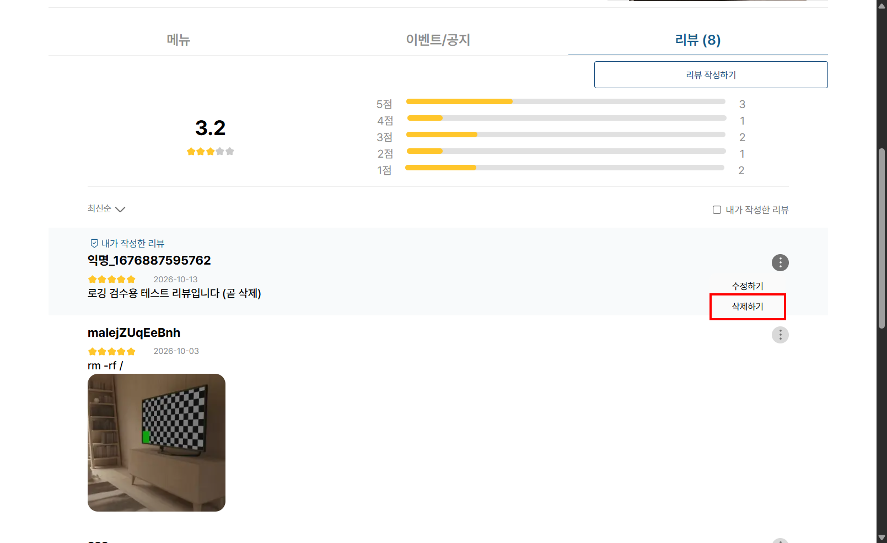
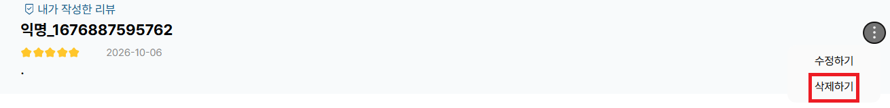
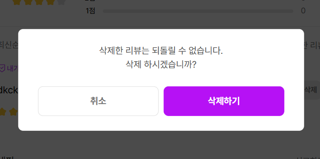

# 3-19 상점상세 리뷰 삭제하기  (클릭) 

원문 페이지 ID: c980221954bc8328aadc0162196c00f1

> 원문 스냅샷. 명세 확정·앱 배포·수집 완료를 뜻하지 않습니다.

## 원문 속성

```json
{
  "platform": [
    "WEB",
    "ANDROID",
    "IOS"
  ],
  "url": "source-page-id:c980221954bc8328aadc0162196c00f1",
  "상태": "완료",
  "생성일": "2026-11-08T10:51:50.531Z",
  "이벤트 이름": "<p>\n3-19 상점상세 리뷰 삭제하기  (클릭) \n</p>",
  "태그": [
    "3. 상점 상세 페이지"
  ]
}
```

<details>
<summary>이전 로깅</summary>

<span color="orange">event\_params.key</span>

<ul>
<li>
event\_label : shop\_detail\_view\_review\_delete
</li>
<li>
value : \{상점이름\} 
</li>
<li>
event\_category : click
</li>
</ul>
</details>

<details>
<summary>새 로깅 (26.10.17)</summary>

- 설명: 상점 상세 화면(리뷰 탭)에서 내가 쓴 리뷰의 삭제 버튼을 클릭하는 경우
- screen\_view: <code>shop_detail</code>
- event\_name: <code>DA1</code>
- event\_label: <code>shop__shop_detail__review_delete__open__click</code>
- value: \{상점이름\} (예: 복지관 매점)
- event\_category: <code>click</code>

<details>
<summary>검토사항</summary>

- WEB 실화면 재검수 (2026-10-30): 실제 내 리뷰 삭제 메뉴를 촬영해 WEB 대표사진으로 보완했다. 삭제 버튼 위치를 육안 검수했으며 최종 삭제 확인창과 구분한다. 모바일 촬영은 보류한다.
- 통합 가이드: [로깅 통합 가이드](3c30221954bc8214b1c481c5bbb6fba5.md)
- 사진 플랫폼 확인 완료 (이미지 비율 기준: 웹, 1609x985): stage 캡처(shop\_review\_delete\_menu.png)는 웹 토글이 맞다.
- label DA2 기준 정렬 (2026-10-27): <code>shop__shop_detail__review_delete__click</code> → <code>shop__shop_detail__review_delete__open__click</code>
- 사진 단계 구분 (2026-10-30): 모바일의 기존 확인 팝업을 삭제 열기 버튼의 대표사진으로 해석하지 않도록 보조자료로 명시했다. 사진은 보존하며 해당 버튼이 보이는 실제 앱 캡처는 보류한다. 라벨·value·category·발생 조건은 바꾸지 않는다.
</details>

### 참고사진 (리뷰 삭제 버튼)

<columns>
<column ratio="50">
<b>웹</b>

<details>
<summary>참고사진 · 웹</summary>

<image source="assets/5aad5e02-b283-40a2-b694-8e3d867eef74.png">
WEB · stage 실제 내 리뷰의 삭제하기 버튼. 빨간 테두리는 삭제 확인창을 열기 전 진입 버튼이다. 닉네임·리뷰 본문·연락처가 포함될 수 있는 영역은 검은색 마스킹. 실제 삭제는 수행하지 않았다.
</image>
</details>

<details>
<summary>교체 전 참고사진 · 웹 (이력)</summary>

웹 — 리뷰 삭제 버튼 클릭 (출처: stage 실제 캡처, 빨간 네모 = 클릭 위치)



웹 — 리뷰 삭제 버튼 클릭 (출처: 기존 캡처)


</details>
</column>
<column ratio="50">
<b>모바일</b>

<details>
<summary>참고사진 · 모바일</summary>

모바일 — 보조자료: 삭제 확인창이 열린 이후의 기존 화면. 이 사진은 3-19의 삭제 버튼 클릭 위치를 보여주지 않는다. 삭제 버튼이 보이는 앱 대표사진은 추가 필요하며 최종 삭제 단계(3-20)와 구분한다.


</details>
</column>
</columns>
</details>
