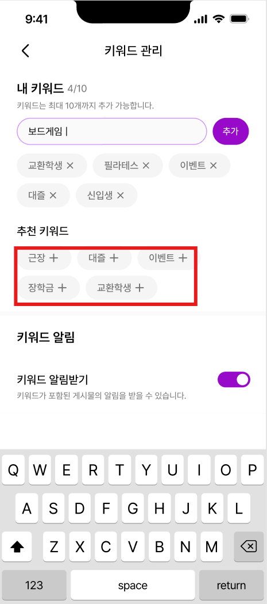

# 7-5. 추천 키워드_클릭

원문 페이지 ID: d3c0221954bc82b384f6018365f7f75c

> 원문 스냅샷. 명세 확정·앱 배포·수집 완료를 뜻하지 않습니다.

## 원문 속성

```json
{
  "platform": [
    "ANDROID",
    "IOS"
  ],
  "url": "source-page-id:d3c0221954bc82b384f6018365f7f75c",
  "상태": "로깅 필요",
  "이름": "7-5. 추천 키워드\\_클릭",
  "태그": [
    "7. 키워드 관리(APP)"
  ]
}
```

<details>
<summary>이전 로깅</summary>

<image source="assets/4a1dd773-ce6f-4878-9c6a-cd737183b248.png">
키워드를 value값으로 추가
</image>


</details>

<details>
<summary>새 로깅 (26.10.05) — 초안</summary>

- 설명: 키워드 관리 화면에서 추천 키워드 선택.
- screen\_view: <code>notice_keyword_manage</code>
- event\_name: <code>DA2</code>
- event\_label: <code>board__notice_keyword_manage__keyword_manage__recommended_keyword__select</code>
- value: \{선택한 키워드\}
- event\_category: <code>select</code>

<details>
<summary>검토사항</summary>

- label 통일 (2026-10-27): <code>board__notice_keyword_manage__keyword_manage__recommended_keyword_select</code> → <code>board__notice_keyword_manage__keyword_manage__recommended_keyword__select</code>
</details>

<details>
<summary>참고사진 · 모바일</summary>

<b>모바일</b>


</details>
</details>


