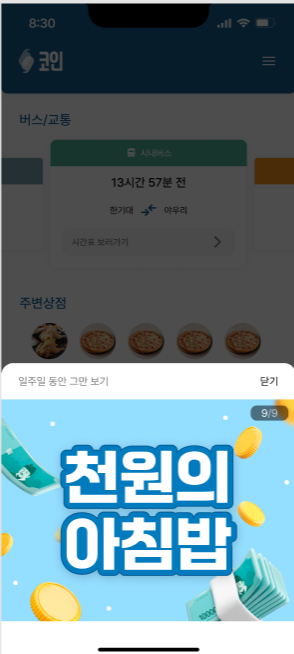
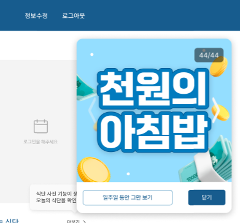

# 1-1. 메인_모달진입

원문 페이지 ID: d410221954bc837fa2b9814c8c3d66f0

> 원문 스냅샷. 명세 확정·앱 배포·수집 완료를 뜻하지 않습니다.

## 원문 속성

```json
{
  "platform": [
    "WEB",
    "ANDROID",
    "IOS"
  ],
  "url": "source-page-id:d410221954bc837fa2b9814c8c3d66f0",
  "상태": "로깅 필요",
  "이름": "1-1. 메인\\_모달진입",
  "태그": [
    "1. 메인_모달"
  ]
}
```

<details>
<summary>이전 로깅</summary>

<ul>
<li>
설명: 메인화면 모달이 사용자에게 뜨는 순간 찍히는 로깅
</li>
<li>
event\_name : “CAMPUS”
</li>
<li>
event\_label : “main\_modal\_entry”
</li>
<li>
value : \{title값\}
</li>
<li>
event\_category : “entry” 
</li>
<li>
참고사진
</li>
</ul>



- 웹 참고사진


</details>

<details>
<summary>새 로깅 (26.10.12) — 초안</summary>

- 설명: 메인 화면의 배너 모달이 사용자에게 실제로 표시되는 순간 기록.
- screen\_view: main
- event\_name: <code>DA2</code>
- event\_label: <code>banner__main__modal__exposure</code>
- value: \{배너 ID\}
- event\_category: <code>exposure</code>

<details>
<summary>참고사진 · 웹</summary>

<image source="assets/dbdc8348-aa51-4091-afb3-6b07b3f8f95b.png">
WEB · 운영 사이트 실제 메인 모달 노출. 빨간 테두리=모달 전체. 2026-10-30 캡처.
</image>
</details>

<details>
<summary>검토사항</summary>

- 사진 재검수 (2026-10-30): 운영 WEB 메인 모달을 새 로깅 영역에 보완했다. 보라색 모바일 홈에서는 같은 모달 노출을 확인하지 못해 모바일 사진은 임의 재사용하지 않았다. 모바일 노출 조건·SDK 발화는 추가 확인이 필요하다.
- 검토 메모 (2026-10-28): 기존 실제 모달 노출 순간 조건과 value·event\_name·category·플랫폼·기존 사진을 유지한다. 네이밍 정리로 서버 성공 이벤트나 추가 전송을 만들지 않으며, SDK 발화·한 번 전송은 미확인이다.
</details>

### 참고사진 (메인 모달 노출 · 기존 캡처 참조 사본)

<columns>
<column ratio="50">
웹

<details>
<summary>참고사진 · 웹</summary>

<image source="assets/b6cb0d15-55de-4a2e-a86c-200f9094b3f9.png">
기존 이전 로깅의 웹 모달 노출 사진을 픽셀 변경 없이 별도 업로드한 참조 사본. 이전 로깅의 원본·사진 위치는 보존한다. 노출 이벤트여서 클릭 박스를 추가하지 않는다. 현재 배포 UI·SDK 발화 검증 완료를 뜻하지 않는다.
</image>
</details>
</column>
<column ratio="50">
모바일

<details>
<summary>참고사진 · 모바일</summary>

파란색 구버전 모바일 사진 제거 (2026-10-30).
</details>
</column>
</columns>
</details>
