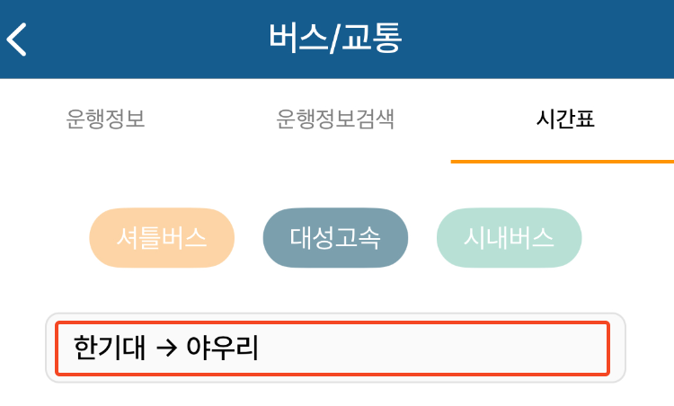

# 3-9. 버스_시간표_학교셔틀_시간&장소_클릭

원문 페이지 ID: d950221954bc825aacc1013101601614

> 원문 스냅샷. 명세 확정·앱 배포·수집 완료를 뜻하지 않습니다.

## 원문 속성

```json
{
  "platform": [
    "ANDROID",
    "IOS",
    "WEB"
  ],
  "url": "source-page-id:d950221954bc825aacc1013101601614",
  "구분": "시간표 (WEB / Android / iOS)",
  "상태": "레거시",
  "생성일": "2026-11-08T10:51:40.808Z",
  "이벤트 이름": "3-9. 버스\\_시간표\\_학교셔틀\\_시간&장소\\_클릭",
  "태그": [
    "3. 버스/교통 상세 페이지"
  ]
}
```

<details>
<summary>이전 로깅</summary>

- event\_label : “bus\_timetable\_time”
- value : “\{드롭다운 목록\}<b>”</b>
- event\_category : “click”
- 참고사진



---

<span color="orange">(web만 재로깅 부탁드립니다)</span>

웹의 경우 event\_label이 “bus\_timetable\_shuttle\_route”으로 로깅되어 있어 안드, iOS와 상이합니다.<br />event\_label : “bus\_timetable\_shuttle\_route” → “<u>bus\_timetable\_time”</u>로 변경 부탁드립니다.
</details>

<details>
<summary>새 로깅 (26.10.17)</summary>

- 레거시: 지금 앱에 없는 화면(구 시간표의 학교셔틀 드롭다운)이라 새 로깅을 만들지 않는다.
- 대체 로깅: 4-6. 지역별 세부 노선\_클릭 (<code>bus__bus_timetable__shuttle_route__entry__click</code>)

<details>
<summary>검토사항</summary>

- 통합 가이드: [로깅 통합 가이드](3c30221954bc8214b1c481c5bbb6fba5.md)
- 레거시 항목이라 새 로깅·참고사진 없음.
</details>

### 참고사진 (기능 표시)

<columns>
<column ratio="50">
<b>웹</b>

<details>
<summary>참고사진 · 웹</summary>

웹 — 해당 없음 (레거시)
</details>
</column>
<column ratio="50">
<b>모바일</b>

<details>
<summary>참고사진 · 모바일</summary>

모바일 — 해당 없음 (레거시)
</details>
</column>
</columns>
</details>
