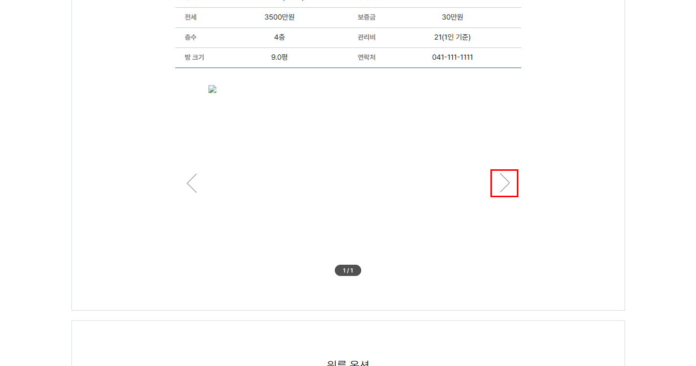

# 3-1 복덕방 상세_사진 넘기기 (클릭) - 추가된 로깅

원문 페이지 ID: d9f0221954bc83b498ea81770498b28c

> 원문 스냅샷. 명세 확정·앱 배포·수집 완료를 뜻하지 않습니다.

## 원문 속성

```json
{
  "platform": [
    "ANDROID",
    "IOS",
    "WEB"
  ],
  "url": "source-page-id:d9f0221954bc83b498ea81770498b28c",
  "상태": "로깅 필요",
  "생성일": "2026-11-08T10:51:51.306Z",
  "이벤트 이름": "3-1 복덕방 상세\\_사진 넘기기 (클릭) - 추가된 로깅"
}
```

<details>
<summary>이전 로깅</summary>

- 없음 (새로 추가한 로깅)
</details>

<details>
<summary>새 로깅 (26.10.17)</summary>

- 설명: 복덕방 상세 화면의 방 사진 슬라이드에서 이전 / 다음 화살표를 클릭하는 경우
- screen\_view: <code>room_detail</code>
- event\_name: <code>DA1</code>
- event\_label: <code>real_estate__room_detail__photo_view__slide__click</code>
- value: 이전 / 다음 (예: 다음)
- event\_category: <code>click</code>

<details>
<summary>검토사항</summary>

- 통합 가이드: [로깅 통합 가이드](3c30221954bc8214b1c481c5bbb6fba5.md)
- 모바일에서 스와이프로 넘기면 category는 swipe로 따로 볼지 확인 필요
- label DA2 기준 정렬 (2026-10-27): <code>real_estate__room_detail__photo__click</code> → <code>real_estate__room_detail__photo_view__slide__click</code>
</details>

### 참고사진 (사진 슬라이드 다음 화살표)

<columns>
<column ratio="50">
<b>웹</b>

<details>
<summary>참고사진 · 웹</summary>

웹 — 사진 넘기기 (출처: stage 실제 캡처, 빨간 네모 = 클릭 위치)


</details>
</column>
<column ratio="50">
<b>모바일</b>

<details>
<summary>참고사진 · 모바일</summary>

<image source="assets/a00e3e64-0ee9-4b9f-abd3-b578c7c336a3.png">
모바일 웹 · 운영 [https://koreatech.in/room/4](https://koreatech.in/room/4) 실제 파란색 화면을 2026-10-30에 캡처. 빨간 테두리: 상세 사진 오른쪽의 다음 화살표. 현재 매물 사진은 1/1이므로 실제 사진 전환은 미확인. Android/iOS 네이티브 앱 캡처가 아니며 SDK 발화·한 번 전송은 미확인.
</image>
</details>
</column>
</columns>
</details>
