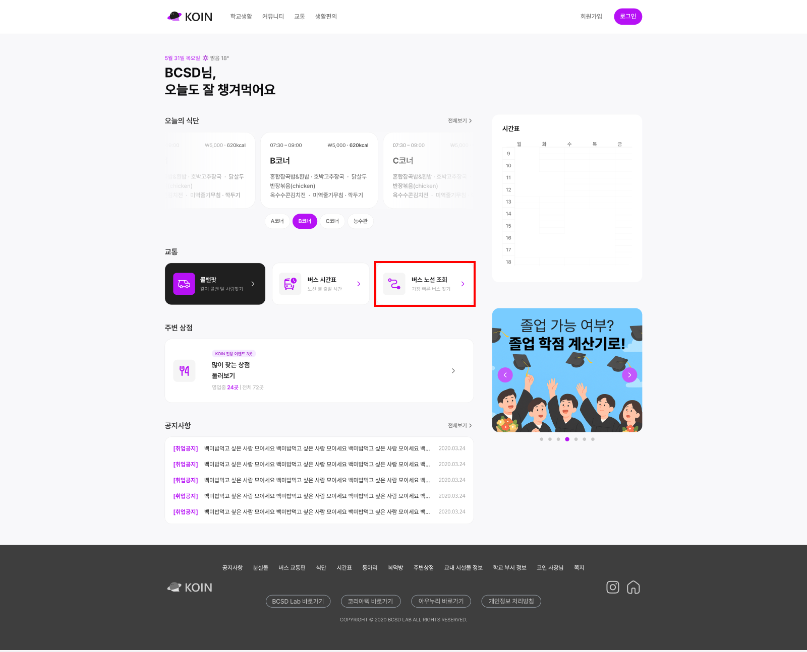
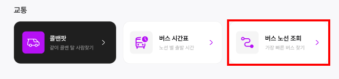
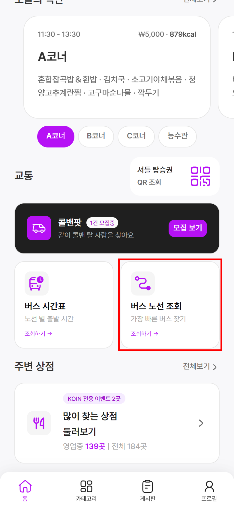

# 1-13. 교통편 조회하기_클릭 (레거시)

원문 페이지 ID: e410221954bc83e1aa4681d6391b6a86

> 원문 스냅샷. 명세 확정·앱 배포·수집 완료를 뜻하지 않습니다.

## 원문 속성

```json
{
  "platform": [
    "ANDROID",
    "IOS",
    "WEB"
  ],
  "url": "source-page-id:e410221954bc83e1aa4681d6391b6a86",
  "상태": "로깅 필요",
  "생성일": "2026-11-08T10:51:37.891Z",
  "이벤트 이름": "1-13. 교통편 조회하기\\_클릭 (레거시)",
  "태그": [
    "1. 메인_버스/교통"
  ]
}
```

<callout icon="📁" color="gray_bg">
<b>레거시 보존 · 현행 새 로깅은 홈으로 이관</b>

- 2026-11-04 사용자 지시로 이 페이지는 이력만 보존한다.
- 현행 기준 명세: [1-8 버스 노선 클릭](2690221954bc82dea77301b070152451.md).
- 이관 후 event\_label: <code>main__main__bus_entry__search_entry__click</code>. 아래 이관 전 라벨·값·사진은 보존 기록이며 별도 신규 구현·추가 전송 대상으로 사용하지 않는다.
- 실제 SDK 전환·배포·수집 중단 여부는 미확인이다. 기존 플랫폼과 상태 속성은 유지했다.
</callout>

<details>
<summary>이전 로깅</summary>

- event\_label : “main\_bus\_search”
- value : “가장 빠른 버스 조회하기<b>”</b>
- event\_category : “click”
- 참고사진

<image source="assets/0e87ba01-22ff-4d02-992d-30441241cd31.png">
AND, IOS, WEB(Mobile view)
</image>

<image source="assets/386b66ae-21ba-41ea-b3f2-09f283dc3838.png">
WEB
</image>
</details>

<details>
<summary>이관 전 새 로깅 (26.10.17) — 레거시 보존</summary>

- 설명: 메인 화면 교통 영역에서 버스 노선 조회 카드를 클릭해 버스 교통편 화면으로 들어가는 경우
- screen\_view: <code>main</code>
- event\_name: <code>DA1</code>
- event\_label: <code>bus__main__bus_entry__search_entry__click</code>
- value: 버스 노선 조회
- event\_category: <code>click</code>

<details>
<summary>검토사항</summary>

- WEB 참고사진 반영 (2026-11-04 사용자 요청 정정): 아래 새 WEB 캡처와 빨간 네모·확대본을 기준으로 클릭 위치를 확인한다. 리디자인 전 WEB 사진은 이력으로 보존하며 모바일 사진·명세와 이전 로깅은 유지한다.
- WEB 리디자인 반영 (2026-11-04 사용자 승인): WEB: 리디자인 홈 ‘교통’ 영역 ‘버스 노선 조회’ 카드 클릭으로 교통편 화면에 진입할 때 기존 새 명세를 적용한다. 홈 1-8은 참조 문서이며 문서 수만큼 추가 전송하지 않는다. ANDROID·IOS 정의는 유지한다.
- WEB 설계 근거: [Figma 참고 / 실제 화면 미확인](https://www.figma.com/design/DPlcYuiFxhyT5ULbqec59i/KOIN-Web?node-id=11541-33352). 기존 사진은 교체하지 않았으며 리디자인 화면의 위치 근거로 사용하지 않는다. SDK 구현·배포 시점·실제 수집은 미확인이다. 이 WEB 규정은 해당 화면의 과거 WEB 설명보다 우선하며 모바일·이전 로깅·기존 필드 값·DB 플랫폼 속성은 보존한다.
- 통합 가이드: [로깅 통합 가이드](3c30221954bc8214b1c481c5bbb6fba5.md)
- 웹/모바일 참고사진 추가 완료 (stage 캡처에 빨간 네모, 2026-10-28).
- label DA2 기준 정렬 (2026-10-27): <code>bus__main__route__click</code> → <code>bus__main__bus_entry__search_entry__click</code>
</details>

### 참고사진 (기능 표시)

<b>웹</b>

<details>
<summary>참고사진 · 웹</summary>

WEB 리디자인 · [Figma 시안](https://www.figma.com/design/DPlcYuiFxhyT5ULbqec59i/KOIN-Web?node-id=11541-33352) · 2026-11-04. 빨간 네모는 이 명세의 클릭 위치다. 원본 캡처에 코드로 테두리만 표시했으며 실제 서비스 캡처·배포 완료를 의미하지 않는다.

<b>전체 화면</b>



<b>클릭 위치 확대</b>



<details>
<summary>이전 WEB 참고사진 (리디자인 전)</summary>

<image source="assets/52ceeb66-5bfb-492b-9828-0a2301586b20.png">
WEB · 빨간 네모: 메인 교통편 조회 카드 클릭. stage 실제 화면 캡처에 위치 표시.
</image>
</details>
</details>

<b>모바일</b>

<details>
<summary>참고사진 · 모바일</summary>

모바일 — 버스 노선 조회 카드 (출처: stage 실제 캡처, 빨간 네모 = 클릭 위치)


</details>
</details>
