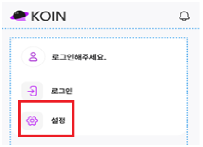

# 4-4 설정 클릭

원문 페이지 ID: e970221954bc8343a033814f6e351651

> 원문 스냅샷. 명세 확정·앱 배포·수집 완료를 뜻하지 않습니다.

## 원문 속성

```json
{
  "platform": [
    "ANDROID",
    "IOS"
  ],
  "url": "source-page-id:e970221954bc8343a033814f6e351651",
  "구분": "프로필",
  "상태": "완료",
  "생성일": "2026-11-12T05:08:01.188Z",
  "이벤트 이름": "4-4 설정 클릭"
}
```

<details>
<summary>과거 로깅</summary>

- event\_label : home\_settings
- value : 설정
- event\_category : click





</details>

<details>
<summary>새 로깅</summary>

- screen\_view: <code>main_profile</code>
- event\_name: <code>DA2</code>
- event\_label: <code>account__main_profile__account_config__entry__click</code>
- value: 설정
- event\_category: <code>click</code>
- 설명: 프로필 화면에서 설정을 클릭한다.

<b>참고사진 · 모바일</b>

<image source="assets/5f056b17-81f1-4018-a4ea-a28b46819b4a.png">
모바일 웹 · 2026-10-30 [stage.koreatech.in/profile의](http://stage.koreatech.in/profile%EC%9D%98) 보라색 실제 프로필 화면. 빨간 테두리=설정 진입 버튼. 식별 정보는 검은색 마스킹. 클릭 시 현재 준비 중 안내가 표시되므로 설정 진입 성공이나 네이티브 앱 동작을 입증하는 사진은 아니다. 기존 명세·SDK 발화는 미확인이다.
</image>
</details>
