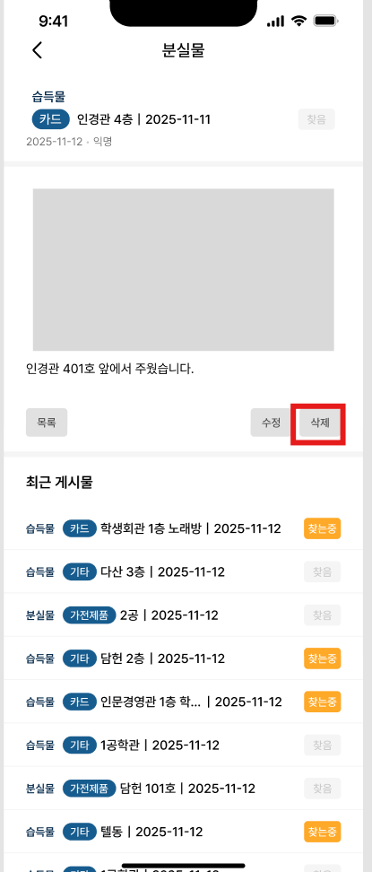
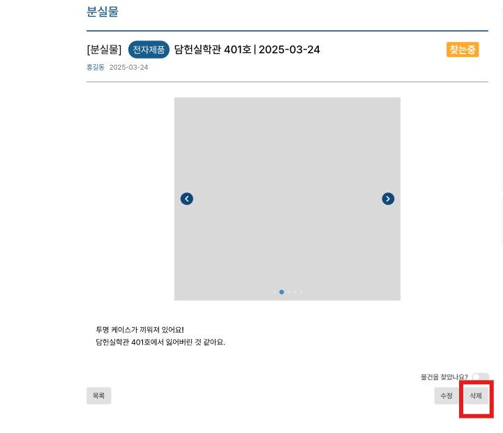
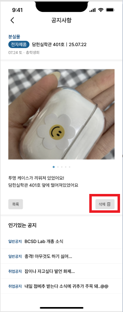
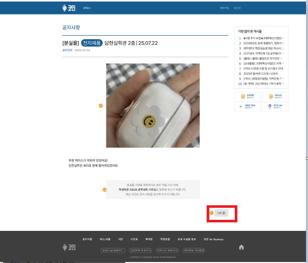
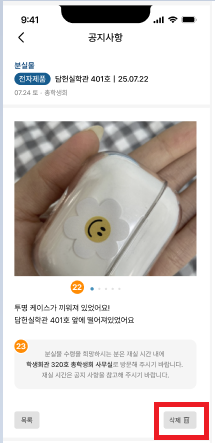
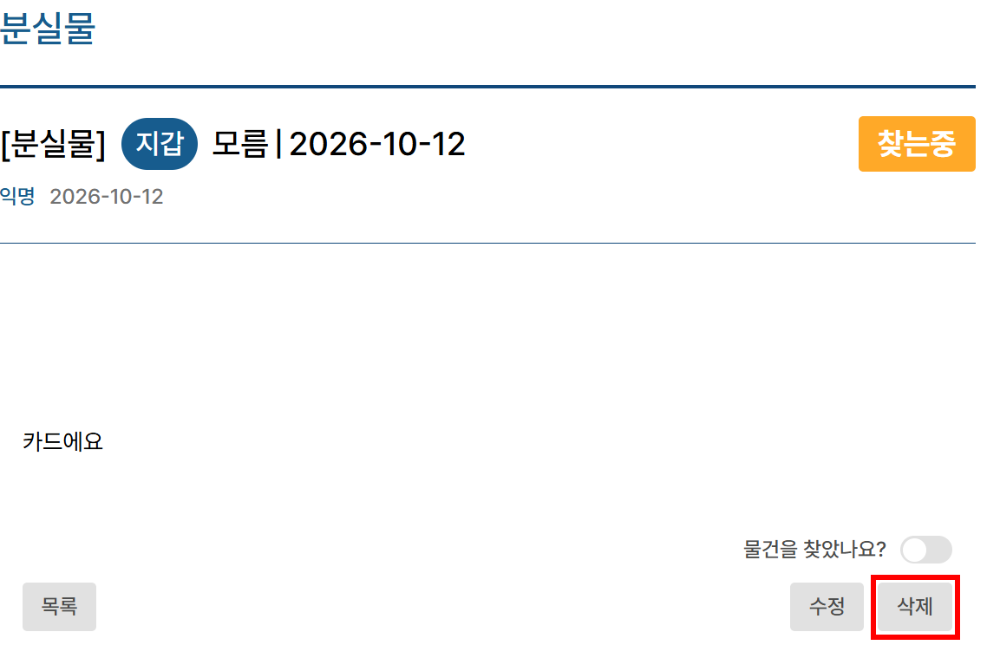
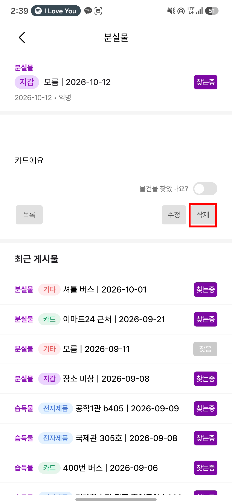

# 11-5.분실물_습득물_삭제_클릭

원문 페이지 ID: eb20221954bc832981c081c4c9f7b5ce

> 원문 스냅샷. 명세 확정·앱 배포·수집 완료를 뜻하지 않습니다.

## 원문 속성

```json
{
  "platform": [
    "ANDROID",
    "IOS",
    "WEB"
  ],
  "url": "source-page-id:eb20221954bc832981c081c4c9f7b5ce",
  "상태": "완료",
  "이름": "11-5.분실물\\_습득물\\_삭제\\_클릭",
  "태그": [
    "11.분실물"
  ]
}
```

<details>
<summary>이전 로깅</summary>

<ul>
<li>
설명:  글 작성자가 습득물 신고 게시물에서 삭제버튼을 클릭. 글 종류에 따라 value를 달리 해주시면 감사하겠습니다. 
</li>
<li>
event\_label : “find\_user\_delete”
</li>
<li>
value : ‘분실물’ or ‘습득물’
</li>
<li>
event\_category : “click”
</li>
<li>
참고사진
</li>
</ul>





<details>
<summary>이전 참고사진</summary>






WEB Mobile View


</details>


</details>

<details>
<summary>새 로깅 (26.10.12) — 초안</summary>

- 설명: 글 작성자가 습득물 신고 게시물에서 삭제버튼을 클릭.
- screen\_view: <code>lost_item_detail</code>
- event\_name: <code>DA2</code>
- event\_label: <code>board__lost_item_detail__lost_item_delete__open__click</code>
- value: 분실물 / 습득물
- event\_category: <code>click</code>

<details>
<summary>검토사항</summary>

- 통합 가이드·후속: 원문 (원문 ID: 4129ae650b598060bb4bdf347b7d4c7a)
- label 통일 (2026-10-27): <code>board__lost_item_detail__lost_item_delete__open</code> → <code>board__lost_item_detail__lost_item_delete__open__click</code>
- 원본 제목은 습득물 삭제이지만 설명과 value는 분실물·습득물을 모두 포함하므로 글 종류로 구분합니다.
</details>

### 참고사진 (기능 표시)

<columns>
<column ratio="50">
<b>웹</b>

<details>
<summary>참고사진 · 웹</summary>

웹 — 본인 게시물 삭제


</details>
</column>
<column ratio="50">
<b>모바일</b>

<details>
<summary>참고사진 · 모바일</summary>

모바일 — 본인 게시물 삭제


</details>
</column>
</columns>
</details>
