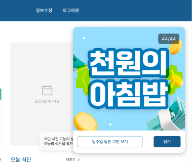
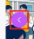
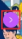

# 1-6. (웹)메인_다음모달_클릭

원문 페이지 ID: ec40221954bc82c0b92a011f98444bef

> 원문 스냅샷. 명세 확정·앱 배포·수집 완료를 뜻하지 않습니다.

## 원문 속성

```json
{
  "platform": [
    "WEB"
  ],
  "url": "source-page-id:ec40221954bc82c0b92a011f98444bef",
  "상태": "로깅 필요",
  "이름": "1-6. (웹)메인\\_다음모달\\_클릭",
  "태그": [
    "1. 메인_모달"
  ]
}
```

<details>
<summary>과거 로깅</summary>

- 설명: 메인화면 모달의 다음 모달 버튼을 클릭
- event\_name : “CAMPUS”
- event\_label : “main\_next\_modal”
- value : \{title값\}
- event\_category : “click”
- 참고사진


</details>

<details>
<summary>새 로깅</summary>

### 이전

- 설명: PC 메인 화면의 고정 배너 이전·다음 화살표를 직접 클릭했을 때 해당 방향으로 한 번 기록한다. 자동 전환과 하단 점 선택은 포함하지 않는다.
- screen\_view: <code>main</code>
- event\_name: <code>DA2</code>
- event\_label: <code>banner__main__fixed_banner__previous__click</code>
- value: \{클릭 직전 표시 중인 배너 제목\}
- event\_category: <code>click</code>

### 다음

- 설명: PC 메인 화면의 고정 배너 이전·다음 화살표를 직접 클릭했을 때 해당 방향으로 한 번 기록한다. 자동 전환과 하단 점 선택은 포함하지 않는다.
- screen\_view: <code>main</code>
- event\_name: <code>DA2</code>
- event\_label: <code>banner__main__fixed_banner__next__click</code>
- value: \{클릭 직전 표시 중인 배너 제목\}
- event\_category: <code>click</code>

### 참고사진 · 웹





<image source="assets/039ffcd6-f960-4835-852c-5d30f669a517.png">
Stage 실제 화면 · 빨간 네모가 해당 클릭 대상
</image>
</details>
