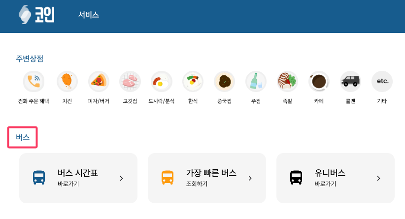
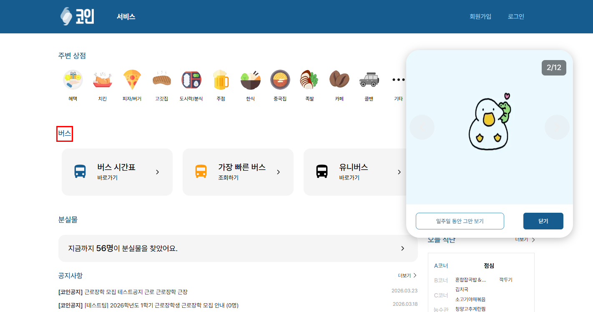

# [레거시] 1-14. 메인_버스_클릭

원문 페이지 ID: f450221954bc8321ab2e8140e800c375

> 원문 스냅샷. 명세 확정·앱 배포·수집 완료를 뜻하지 않습니다.

## 원문 속성

```json
{
  "platform": [
    "WEB",
    "ANDROID",
    "IOS"
  ],
  "url": "source-page-id:f450221954bc8321ab2e8140e800c375",
  "상태": "레거시",
  "생성일": "2026-11-08T10:51:36.371Z",
  "이벤트 이름": "\\[레거시\\] 1-14. 메인\\_버스\\_클릭",
  "태그": [
    "1. 메인_버스/교통"
  ]
}
```

<callout icon="📁" color="gray_bg">
<b>레거시 보존 · 현행 기준은 홈화면 리디자인</b>

- 2026-11-05 사용자 지시: 홈화면 리디자인의 로깅은 모두 유지하고, 겹치는 다른 서비스 명세를 레거시로 보존한다.
- 메인 버스 노선 조회의 현행 기준: [1-8 버스 노선 클릭](2690221954bc82dea77301b070152451.md).
- 이 페이지는 별도 신규 구현·추가 전송 대상이 아니다. 아래 라벨·value·category·event\_name·screen\_view·사진·플랫폼과 이전 로깅은 이력으로 보존한다.
- 이전의 ‘이 페이지가 대표’·‘두 문서 별개 유지’·‘같은 라벨 문서 계약’ 설명은 이 최신 결정으로 대체한다. 홈 명세의 라벨·값·필드는 이번 작업에서 변경하지 않는다.
- 실제 SDK의 옛 라벨 중단·전환·단일 전송은 미확인이다. 이 문서 정리는 운영 코드나 데이터의 삭제·변경을 뜻하지 않는다.
</callout>

<details>
<summary>이전 로깅</summary>

- event\_label : “main\_to\_bus”
- value : “버스<b>”</b>
- event\_category : “click”
- 참고사진



- 설명 : 클릭 시 \[가장 빠른 버스 조회하기\]와 동일한 버튼

<image source="assets/1836f8f7-cf40-4805-a1e4-986c12f11ac9.png">
위 화면으로 이동
</image>
</details>

<details>
<summary>이관 전 새 로깅 (26.10.17) — 레거시 보존</summary>

- 설명: 메인 화면에서 버스 버튼을 클릭해 버스 조회 화면으로 들어가는 경우 (\[가장 빠른 버스 조회하기\]와 같은 화면으로 이동)
- screen\_view: <code>main</code>
- event\_name: <code>DA1</code>
- event\_label: <code>bus__main__bus_entry__main_entry__click</code>
- value: 버스
- event\_category: <code>click</code>

<details>
<summary>검토사항</summary>

- 홈 리디자인 중복 후보 (2026-11-05): 이 페이지의 WEB(모바일) 사진은 버스 노선 조회 카드를 가리키며 홈 1-8 [1-8 버스 노선 클릭](2690221954bc82dea77301b070152451.md)과 같은 클릭 위치다. 새 홈의 해당 카드는 홈 1-8을 기준으로 적용하고 이 bus\_\_main 라벨을 함께 추가하지 않는다. 이 페이지의 구디자인 WEB 버스 버튼과 실제 ANDROID·IOS 호출은 별도 대조 대상이며 기존 라벨·value·사진·플랫폼은 이력·전환 검토를 위해 유지한다. SDK 수집 중단·정리는 미확인이다.
- 홈 진입 위치 정렬 (2026-10-28): <code>bus__main__bus_entry__category_entry__click</code> → <code>bus__main__bus_entry__main_entry__click</code>. 홈 버튼·카테고리 카드이므로 screen\_view와 label page는 <code>main</code>을 유지한다. 메뉴 화면의 <code>main_category</code>와 구분한다. 기존 value·category·담당자·플랫폼·발생 시점은 유지한다. 이 명세만으로 실제 중복 발화 여부를 확정하지 않는다.
- 통합 가이드: [로깅 통합 가이드](3c30221954bc8214b1c481c5bbb6fba5.md)
- 기존 본문이 웹·모바일 모두 표기해 DB platform을 WEB, ANDROID, IOS로 맞춤. 참고사진은 stage 캡처 1장이며 사진 플랫폼 확인 완료 (이미지 비율 기준: 웹, 1422x748).
- label DA2 기준 정렬 (2026-10-27): <code>bus__main__category__click</code> → <code>bus__main__bus_entry__category_entry__click</code>
</details>

### 참고사진 (기능 표시)

<columns>
<column ratio="50">
<b>웹</b>

<details>
<summary>참고사진 · 웹</summary>

웹 — 메인 버스 버튼 (출처: stage 실제 캡처, 빨간 네모 = 클릭 위치)


</details>
</column>
<column ratio="50">
<b>모바일</b>

<details>
<summary>참고사진 · 모바일</summary>

<image source="assets/698951b6-0a4f-48d5-bcad-f8ec3e789d78.png">
WEB (모바일) · 빨간 네모: 메인 버스 조회 진입. stage 실제 화면 캡처에 위치 표시.
</image>
</details>
</column>
</columns>
</details>
