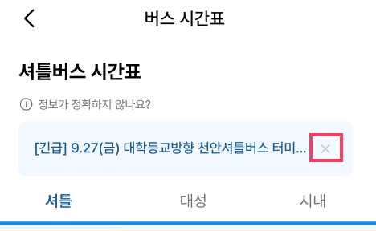
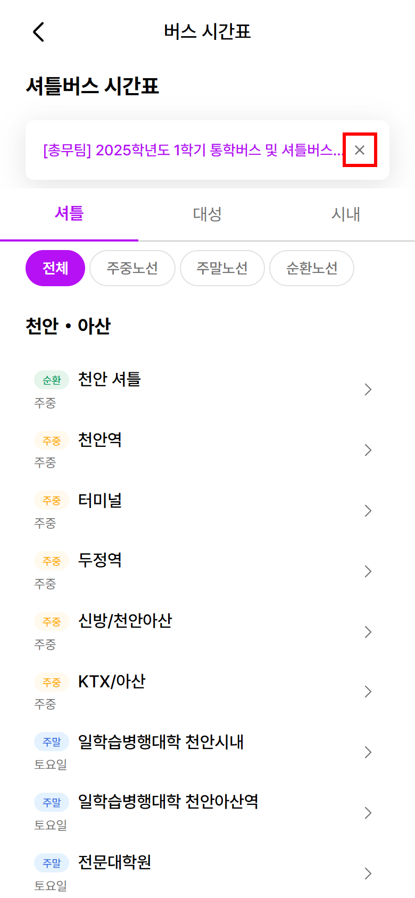

# 4-3. 버스 공지_닫기_클릭

원문 페이지 ID: fb80221954bc826e94880129a5ba896e

> 원문 스냅샷. 명세 확정·앱 배포·수집 완료를 뜻하지 않습니다.

## 원문 속성

```json
{
  "platform": [
    "ANDROID",
    "IOS",
    "WEB"
  ],
  "url": "source-page-id:fb80221954bc826e94880129a5ba896e",
  "상태": "로깅 필요",
  "생성일": "2026-11-08T10:51:39.831Z",
  "이벤트 이름": "4-3. 버스 공지\\_닫기\\_클릭",
  "태그": [
    "4. 버스 시간표"
  ]
}
```

<details>
<summary>이전 로깅</summary>

- event\_label : “bus\_announcement\_close”
- value : <b><span color="orange">이 버튼을 누른 위치</span></b>
  - “셔틀버스 시간표”, “대성버스 시간표”, “시내버스 시간표”
  - “교통편 조회하기”
- event\_category : “click”
- 참고사진



<image source="assets/10be8ec2-6e2c-470e-a728-717b7d597f72.png">
AND, IOS, WEB(Mobile view)
</image>

<image source="assets/95fe6aa6-04be-4b87-998e-6b660c2aadd2.png">
WEB
</image>
</details>

<details>
<summary>새 로깅 (26.10.17)</summary>

- 설명: 버스 시간표 화면 또는 버스 교통편 화면 상단의 버스 공지에서 X(닫기)를 클릭하는 경우
- screen\_view: <code>bus_timetable</code>
- event\_name: <code>DA1</code>
- event\_label: <code>bus__bus_timetable__bus_notice__close__click</code>
- value: 셔틀 / 대성 / 시내 (시간표 화면, 보고 있던 탭) · 버스 교통편 (교통편 화면) (예: 시간표 화면 → 셔틀, 교통편 화면 → 버스 교통편)
- event\_category: <code>click</code>

<details>
<summary>검토사항</summary>

- 통합 가이드: [로깅 통합 가이드](3c30221954bc8214b1c481c5bbb6fba5.md)
- 현재 WEB 참고사진과 모바일 시간표 화면 참고사진 1장이 있다. 모바일의 버스 교통편 화면 사진은 제거되어 없으므로 2장 완료로 표시하지 않는다. 모바일 시간표 사진의 현행 앱 일치·SDK 발화는 별도 확인한다.
- label DA2 기준 정렬 (2026-10-27): <code>bus__bus_timetable__notice__close__click</code> → <code>bus__bus_timetable__bus_notice__close__click</code>
- label DA2 기준 정렬 (2026-10-27): <code>bus__bus_search__notice__close__click</code> → <code>bus__bus_timetable__bus_notice__close__click</code>
- 화면명 정렬 (2026-10-27): 사용자 결정에 따른 고정 논리 화면명 bus\_timetable로 라벨도 정규화했다. 진입 화면별 옛 라벨 중 하나를 고르는 대신 위 새 라벨 하나를 사용하며, 원래 클릭 동작·value는 유지한다.
</details>

### 참고사진 (기능 표시)

<columns>
<column ratio="50">
<b>웹</b>

<details>
<summary>참고사진 · 웹</summary>

<image source="assets/e0f96dc3-8d28-458d-97de-3ad153f34003.png">
WEB · 빨간 네모: 버스 공지 X 닫기. stage 실제 화면 캡처에 위치 표시.
</image>
</details>
</column>
<column ratio="50">
<b>모바일</b>

<details>
<summary>참고사진 · 모바일</summary>

모바일 — 버스 공지 닫기, 시간표 화면 (bus\_timetable) (출처: stage 실제 캡처, 빨간 네모 = 클릭 위치)



파란색 구버전 모바일 사진 제거 (2026-10-30).
</details>
</column>
</columns>
</details>
