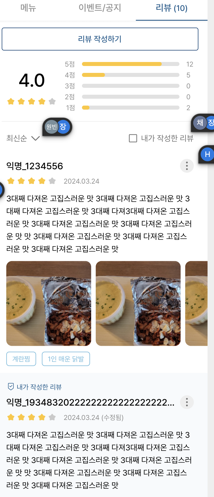
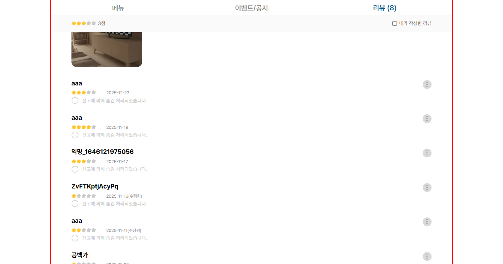
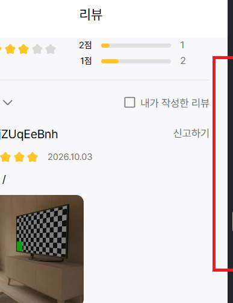

# 3-11 상점상세 리뷰 (스크롤) 

원문 페이지 ID: fdd0221954bc83239303019c56c5fb1f

> 원문 스냅샷. 명세 확정·앱 배포·수집 완료를 뜻하지 않습니다.

## 원문 속성

```json
{
  "platform": [
    "WEB",
    "ANDROID",
    "IOS"
  ],
  "url": "source-page-id:fdd0221954bc83239303019c56c5fb1f",
  "상태": "완료",
  "생성일": "2026-11-08T10:51:46.718Z",
  "이벤트 이름": "<p>\n3-11 상점상세 리뷰 (스크롤) \n</p>",
  "태그": [
    "3. 상점 상세 페이지"
  ]
}
```

<details>
<summary>이전 로깅</summary>

<span color="orange">event\_params.key</span>

<ul>
<li>
event\_label : shop\_detail\_view\_review
</li>
<li>
value : \{상점이름\} 
</li>
<li>
event\_category : scroll
</li>
</ul>





---
</details>

<details>
<summary>새 로깅 (26.10.17)</summary>

- 설명: 상점 상세 화면의 리뷰 탭에서 리뷰 목록을 스크롤하는 경우
- screen\_view: <code>shop_detail</code>
- event\_name: <code>DA1</code>
- event\_label: <code>shop__shop_detail__shop_review__scroll</code>
- value: \{상점이름\} (예: 복지관 매점)
- event\_category: <code>scroll</code>

<details>
<summary>검토사항</summary>

- 모바일 웹 실화면 확인 (2026-10-30): 파란색 모바일 사진을 제거한 자리에 현행 보라색 리뷰 목록을 보완했다. 리뷰 화면 촬영 원본을 재사용했으며 위치 표시만 바꿨다. 현재 리뷰 1개인 화면으로 실제 스크롤 발생·SDK 발화는 증명하지 않는다.
- 통합 가이드: [로깅 통합 가이드](3c30221954bc8214b1c481c5bbb6fba5.md)
- label DA2 기준 정렬 (2026-10-27): <code>shop__shop_detail__review__scroll</code> → <code>shop__shop_detail__shop_review__scroll</code>
</details>

### 참고사진 (리뷰 목록 스크롤)

<columns>
<column ratio="50">
<b>웹</b>

<details>
<summary>리뷰 목록 · 운영 WEB (2026-10-30)</summary>

<image source="assets/f85826bc-00d7-480b-a6c1-4b66f359984d.png">
WEB · 2026-10-30 운영 주변상점 리뷰 3건 목록. 닉네임·본문은 검은색 마스킹. 빨간 테두리=리뷰 목록 영역. 스크롤 이동을 확인한 화면 참고자료이며 SDK 수집·한 번 전송은 미확인이다.
</image>
</details>

<details>
<summary>참고사진 · 웹</summary>

웹 — 리뷰 목록 스크롤 (출처: stage 실제 캡처, 빨간 네모 = 스크롤하는 리뷰 목록 영역)




</details>
</column>
<column ratio="50">
<b>모바일</b>

<details>
<summary>참고사진 · 모바일</summary>

<image source="assets/f40a329b-2a92-428b-8543-b4620480637a.png">
모바일 웹 · 운영 왕십리야식 보라색 리디자인 리뷰 목록. 동일 실제 리뷰 촬영 프레임을 재사용해 빨간 테두리로 목록 위치를 표시했다. 현재 리뷰 1개이며 스크롤 발화 검증과 구분. 닉네임 검은색 마스킹.
</image>

구버전 모바일 사진을 제거하고 현행 보라색 모바일 웹 사진으로 보완했다.
</details>
</column>
</columns>
</details>
