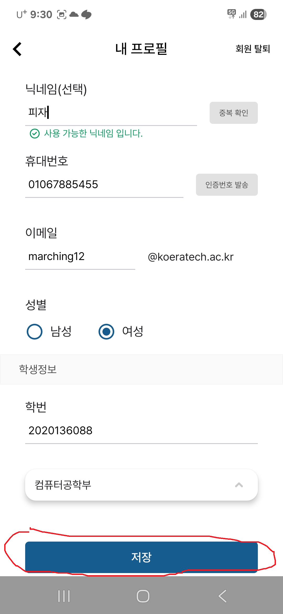

#  3-4 비밀번호수정완료(클릭) 

원문 페이지 ID: ff00221954bc8272936501aa8b95c6e8

> 원문 스냅샷. 명세 확정·앱 배포·수집 완료를 뜻하지 않습니다.

## 원문 속성

```json
{
  "platform": [
    "WEB"
  ],
  "url": "source-page-id:ff00221954bc8272936501aa8b95c6e8",
  "구분": "정보수정",
  "상태": "로깅 필요",
  "생성일": "2026-11-08T10:51:29.257Z",
  "이벤트 이름": "<p>\n 3-4 비밀번호수정완료(클릭) \n</p>",
  "태그": [
    "정보수정"
  ]
}
```

<details>
<summary>이전 로깅</summary>

- event\_label : “user\_info”
- value : “정보수정 완료 or 정보수정 실패<b>”</b>
- event\_category : “click”


웹


모바일


비밀번호 변경에도 심어주세요 ㅎㅎ




</details>

<details>
<summary>새 로깅 (26.10.04)</summary>

- 설명: 정보수정을 통한 비밀번호 변경의 기존 완료·실패 처리 조건에 따라 기록한다. WEB·모바일 모두 논리 화면 password\_change를 사용하며 비밀번호 찾기 경로와 구분한다. 기존 전송 시점과 성공·실패 value는 유지한다.
- event\_name: <code>DA2</code>

<callout icon="☝" color="gray_bg">
비밀번호 찾기가 아닌 정보수정을 통해 변경하는 로깅입니다.
</callout>

- screen\_view: <code>password_change</code>
- event\_label: <code>account__password_change__password_change__confirm__click</code>
- value: 비밀번호 수정 완료 또는 비밀번호 수정 실패
- event\_category: <code>click</code>

<details>
<summary>검토사항</summary>

- 웹·모바일 공통 계약 (2026-11-05 사용자 승인): 같은 기능의 screen\_view와 event\_label은 플랫폼과 관계없이 아래 공통값을 사용한다. 기존 플랫폼별 화면명 유지 지시는 이 결정으로 대체한다. 플랫폼은 기존 DB 속성으로 구분하며 value·event\_name·event\_category·기존 전송 시점·이전 로깅·사진은 유지한다. 실제 SDK 적용·배포·단일 전송은 미확인이다. 공통값: <code>password_change</code> / <code>account__password_change__password_change__confirm__click</code>. 대표 명세는 [ 3-4 비밀번호수정완료(클릭)](fa10221954bc82e49a72810988c0bfca.md)이며 [ 3-4 비밀번호수정완료(클릭) ](ff00221954bc8272936501aa8b95c6e8.md)는 WEB 정보수정 경로 설명이다. 비밀번호 찾기와 일반 프로필 수정의 다른 명세는 변경하지 않는다.
- 사진 재검수 (2026-10-30): WEB 정보수정 경로는 실제 인증 후 화면으로 확인했다. 이 페이지의 기존 모바일 사진을 WEB 근거와 분리했다. password\_change 네이티브 경로가 같은 화면을 재사용하는지는 별도 검증이 필요하다.
- label DA2 기준 정렬 (2026-10-27): <code>account__edit_profile__password_change__submit</code> → <code>account__edit_profile__password_change__confirm__click</code>
- 기존 event\_category click과 전송 시점·성공/실패 value는 유지한다. confirm은 기존 완료/시도 동작을 구분하는 detail이며, 성공 이벤트를 새로 만들지 않는다.
</details>

<details>
<summary>참고사진 · 웹</summary>

<image source="assets/3aa027ce-154e-437f-b52a-9c7c99a3d829.png">
WEB · stage 정보수정 경로의 실제 비밀번호 변경 입력 화면. 개인정보·입력값 검은색 마스킹. 제출하지 않았으므로 변경 결과/SDK 발화 증거는 아님. 2026-10-30.
</image>
</details>

<details>
<summary>교체 전 참고사진 · 모바일 (이력)</summary>

<b>모바일</b>

파란색 구버전 모바일 사진 제거 (2026-10-30).
</details>
</details>
